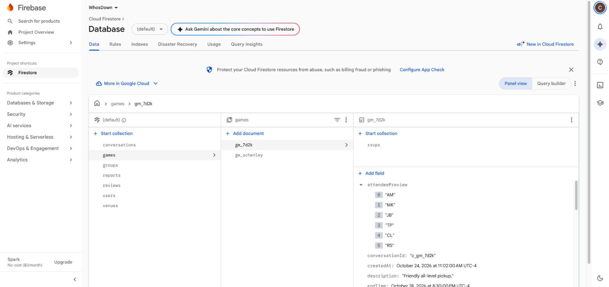
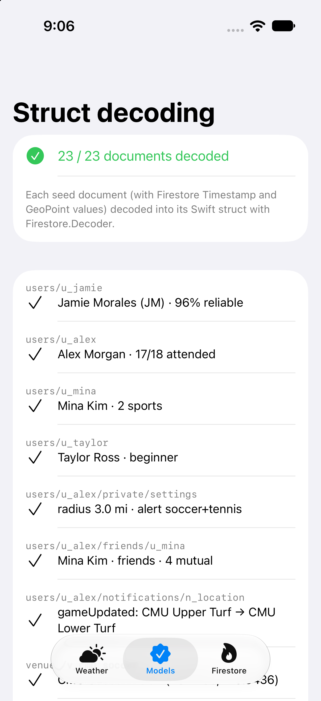
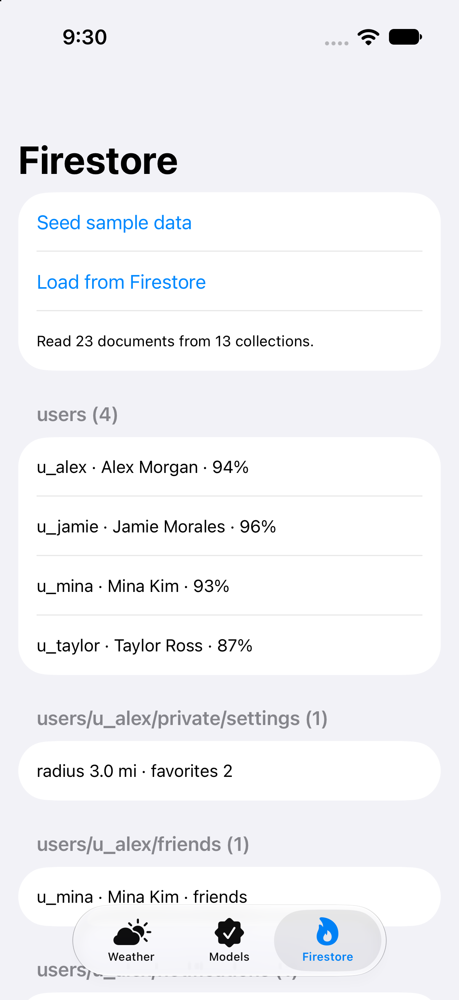
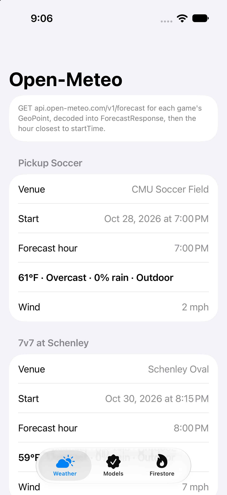
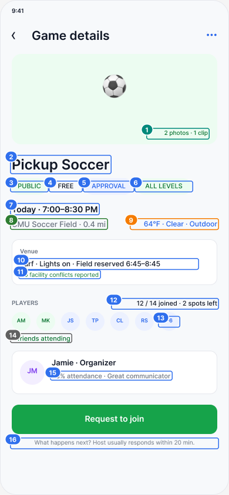
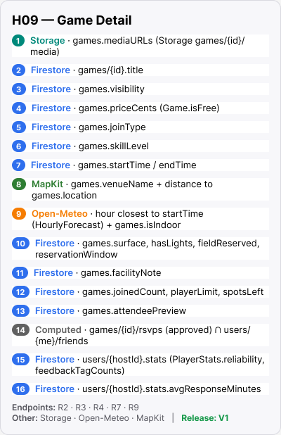

# Sprint 3: APIs and Data

**WhosDown** — a mobile app that makes pickup sports easier
Chris Lee, Jaimin Fee, Kurt Schimmel (Team 6) · 67-443, Fall 2026

---

## Contents

| # | Section | Rubric criterion | Points |
|---|---|---|---|
| 1 | API Assessment | (sets up the Data Sources criteria) | — |
| 2 | Firebase JSON Structure and Setup | Data Sources – Firebase structure established | 8 |
| 3 | Swift Structs | Data Sources – structs for every source | (part of 2, 4) |
| 4 | External API: Open-Meteo Weather (playground) | Data Sources – External API data parsed | 8 |
| 5 | Internal API and On-Device Store | Data Sources – Internal API created / Internal data store | 7 + 7 (not applicable) |
| 6 | Interactive Prototype | Creation of Interactive Prototype | 15 |
| 7 | User Testing Report | User Testing of Prototype | 10 |
| 8 | Wireframe Data Mapping (Figma markup + tables) | Identify Data Needs; Mapping | 30 |
| 9 | Feature List and Delivery Schedule (V1 / V2) | Feature Delivery Schedule | 15 |
| A | Appendix: User Testing Notes | (supports User Testing) | — |

**Files submitted with this document** (folder `Sprint3_Version2/`):

| File | What it is |
|---|---|
| `Code/WhosDownWeather.playground` | Swift playground that calls Open-Meteo and decodes the JSON (Section 4) |
| `Code/Models.swift` | Every Firestore struct and enum (Section 3) |
| `Code/Weather.swift` | Open-Meteo structs used by the app (Section 4) |
| `Screenshots/01_weather_open_meteo.png` | Open-Meteo data decoded and shown in our test app |
| `Screenshots/02_models_decoded.png` | All 23 sample Firestore documents decoded into the Swift structs |
| `Screenshots/03_firestore_console_*.jpg` | Firebase console showing the populated collections |
| `Screenshots/04_firestore_readback*.png` | Test app reading all 23 documents back from Firestore |
| `Screenshots/06_figma_H09_datamap.png`, `07_figma_H09_sources.png` | Example of the marked-up wireframes in Figma (Section 8) |

---

## 1. API Assessment

All WhosDown data (games, RSVPs, profiles, friends, groups, messages, reviews, notifications) is created by our own users. We do not need data from an outside provider for it, and Firebase gives us authentication, a real-time database, file storage, and push messaging without running our own server. For these reasons we use **Firebase** as our backend and **do not build a custom API**.

Two outside services supply the data that users do not create:

| Need | Service | Why |
|---|---|---|
| Accounts, sign-in, guest browsing | Firebase Authentication (email/password + anonymous) | Built-in guest mode; anonymous accounts can be upgraded to email accounts later |
| App data | Cloud Firestore | Real-time listeners keep rosters, RSVP status, and chat up to date without polling |
| Profile photos, game photos and clips, group photos | Firebase Storage | Files are stored in Storage; Firestore keeps only the download URL |
| Push notifications | Firebase Cloud Messaging (FCM) | Approvals, game changes, cancellations, waitlist spots, messages |
| Map, place search, user location, distance | Apple MapKit + Core Location | Native on iOS, no API key, no cost. Replaces the Google Maps plan from Sprint 1 |
| Weather for outdoor games | Open-Meteo forecast API | Free, no API key. Answers our users' "will the field be playable?" concern (Section 4) |
| Add game to calendar | EventKit (on device) | Writes the game to the user's calendar |

**Change since Sprint 1:** we replaced the Google Maps SDK and Places API with Apple MapKit (`Map`, `MKLocalSearch`). MapKit covers map pins, place search, and distance, needs no key or billing account, and fits SwiftUI directly.

---

## 2. Firebase JSON Structure and Setup

### 2.1 Collection tree

```
users/{userId}                       public profile + stats
    private/settings                 owner-only settings (one document)
    friends/{friendId}               friend list and friend requests
    notifications/{notificationId}   in-app notification inbox
venues/{venueId}                     fields, courts, gyms
games/{gameId}                       pickup games
    rsvps/{userId}                   one per player (pending, approved, waitlisted, ...)
groups/{groupId}                     play groups / clubs
    members/{userId}                 group membership
conversations/{conversationId}       direct, game, and group chats
    messages/{messageId}             chat messages
reviews/{reviewId}                   post-game player reviews
reports/{reportId}                   safety reports
```

**Design notes**

- **Denormalized fields.** Values that many screens show (`hostName`, `venueName`, `joinedCount`, `attendeePreview`, `displayName` on RSVPs) are copied into the parent document. A list screen then needs one query, not one query per row.
- **RSVP document ID = user ID.** A user can have only one RSVP per game, and the app can read `games/{gameId}/rsvps/{me}` directly.
- **Counters** (`joinedCount`, `pendingCount`, `waitlistCount`, `memberCount`) are changed in the same Firestore transaction as the RSVP or member write, so they always match.
- **Location search.** Firestore has no radius query, so each game and venue stores a `geohash`. The app queries the geohash ranges that cover the search radius, then filters by exact distance on the device.
- **Text search.** Firestore has no full-text search, so `titleLowercase`, `nameLowercase`, and `displayNameLowercase` support prefix search on the Search screen (H48).
- **Private data.** Email, notification preferences, privacy settings, blocked users, and push tokens are in `users/{id}/private/settings`, which only the owner can read.

In the examples below, Firestore `Timestamp` values are written as ISO 8601 strings and `GeoPoint` values as `{latitude, longitude}`. Every collection has at least one populated record.

### 2.2 Documents

**`users/{userId}`** — public profile

```json
{
  "displayName": "Jamie Morales",
  "displayNameLowercase": "jamie morales",
  "photoURL": null,
  "bio": "Midfielder. I organize weeknight games and keep them welcoming but organized.",
  "homeArea": "Oakland / CMU",
  "schoolLine": "CMU '27",
  "position": "Midfielder",
  "isVerified": true,
  "isGuest": false,
  "playStyles": ["social", "competitive"],
  "sportLevels": { "soccer": "intermediate", "tennis": "casual" },
  "stats": {
    "gamesRSVPd": 32,
    "gamesAttended": 31,
    "gamesHosted": 14,
    "mvpCount": 2,
    "playAgainYes": 16,
    "playAgainTotal": 18,
    "feedbackTagCounts": { "reliable": 12, "goodSport": 9, "communicative": 7 },
    "recentFeedback": ["Clear communication and always shows up."],
    "avgResponseMinutes": 20
  },
  "createdAt": "2026-09-01T18:22:00Z"
}
```

**`users/{userId}/private/settings`** — readable and writable by the owner only

```json
{
  "email": "alex.morgan@example.com",
  "notificationPrefs": {
    "approvals": true,
    "timeOrLocationChanges": true,
    "cancellations": true,
    "reviewReminders": true,
    "newNearbyGames": false,
    "groupActivity": false,
    "messages": true
  },
  "newGameAlert": {
    "sports": ["soccer", "tennis"],
    "radiusMiles": 3.0,
    "weekdaysOnly": true,
    "earliestHour": 17,
    "skillLevels": ["allLevels"]
  },
  "privacy": {
    "gameActivity": "friends",
    "profileVisibility": "whosDownPlayers",
    "directMessages": "friendsAndTeammates",
    "friendRequests": "everyone"
  },
  "blockedUserIds": ["u_83jd"],
  "favoriteVenueIds": ["v_cmu_soccer", "v_schenley_oval"],
  "pinnedGroupIds": ["g_westside"],
  "searchRadiusMiles": 3.0,
  "fcmTokens": ["<device push token>"]
}
```

**`users/{userId}/friends/{friendId}`** — `status` is `requestSent`, `requestReceived`, or `friends`

```json
{
  "displayName": "Mina Kim",
  "status": "friends",
  "mutualCount": 4,
  "since": "2026-10-02T23:10:00Z"
}
```

**`users/{userId}/notifications/{notificationId}`**

```json
{
  "type": "gameUpdated",
  "title": "Pickup Soccer changed location",
  "body": "Jamie: \"Lights are better on the lower turf.\"",
  "gameId": "gm_7d2k",
  "groupId": null,
  "conversationId": null,
  "change": {
    "field": "location",
    "oldValue": "CMU Upper Turf",
    "newValue": "CMU Lower Turf",
    "hostNote": "Lights are better on the lower turf."
  },
  "expiresAt": null,
  "isRead": false,
  "createdAt": "2026-10-28T22:41:00Z"
}
```

**`venues/{venueId}`**

```json
{
  "name": "CMU Soccer Field",
  "address": "5000 Forbes Ave, Pittsburgh, PA 15213",
  "location": { "latitude": 40.4433, "longitude": -79.9436 },
  "geohash": "dppnhf",
  "isIndoor": false,
  "surface": "turf",
  "hasLights": true,
  "sports": ["soccer", "football", "ultimate"],
  "createdBy": "u_jamie"
}
```

**`games/{gameId}`**

```json
{
  "title": "Pickup Soccer",
  "titleLowercase": "pickup soccer",
  "sport": "soccer",
  "customSportName": null,
  "description": "Friendly all-level pickup.",
  "notes": "Bring a light + dark shirt. Need 1 goalkeeper.",
  "hostId": "u_jamie",
  "hostName": "Jamie Morales",
  "groupId": null,
  "venueId": "v_cmu_soccer",
  "venueName": "CMU Soccer Field",
  "location": { "latitude": 40.4433, "longitude": -79.9436 },
  "geohash": "dppnhf",
  "isIndoor": false,
  "surface": "turf",
  "hasLights": true,
  "startTime": "2026-10-28T23:00:00Z",
  "endTime": "2026-10-29T00:30:00Z",
  "skillLevel": "allLevels",
  "visibility": "public",
  "joinType": "approvalRequired",
  "priceCents": 0,
  "playerLimit": 14,
  "waitlistEnabled": true,
  "joinedCount": 12,
  "pendingCount": 2,
  "waitlistCount": 0,
  "attendeePreview": ["AM", "MK", "JB", "TP", "CL", "RS"],
  "fieldReserved": true,
  "reservationWindow": "6:45–8:45 PM",
  "facilityNote": "No field conflict.",
  "mediaURLs": [],
  "status": "scheduled",
  "cancelReason": null,
  "conversationId": "c_gm_7d2k",
  "createdAt": "2026-10-24T15:02:00Z",
  "updatedAt": "2026-10-25T21:40:00Z"
}
```

**`games/{gameId}/rsvps/{userId}`** — `status` is `pending`, `approved`, `declined`, `waitlisted`, `left`, or `removed`

```json
{
  "userId": "u_taylor",
  "displayName": "Taylor Ross",
  "reliability": 0.88,
  "skillLevel": "beginner",
  "status": "pending",
  "isHost": false,
  "noteToHost": "Happy to play defense or learn in goal.",
  "hostResponse": null,
  "waitlistPosition": null,
  "spotOfferExpiresAt": null,
  "attended": null,
  "personalNote": null,
  "requestedAt": "2026-10-25T20:15:00Z",
  "respondedAt": null
}
```

**`groups/{groupId}`**

```json
{
  "name": "West Side Pickup Crew",
  "nameLowercase": "west side pickup crew",
  "description": "Friendly weeknight soccer. Newcomers welcome.",
  "photoURL": null,
  "sports": ["soccer"],
  "localArea": "Oakland / CMU",
  "visibility": "public",
  "membershipType": "open",
  "ownerId": "u_jamie",
  "memberCount": 48,
  "conversationId": "c_grp_westside",
  "createdAt": "2026-09-10T00:00:00Z"
}
```

**`groups/{groupId}/members/{userId}`** — `role` is `owner`, `admin`, `member`, or `pending`

```json
{
  "displayName": "Alex Morgan",
  "role": "member",
  "joinedAt": "2026-10-01T19:00:00Z"
}
```

**`conversations/{conversationId}`** — one collection for direct, game, and group chats

```json
{
  "type": "game",
  "title": "Pickup Soccer",
  "gameId": "gm_7d2k",
  "groupId": null,
  "participantIds": ["u_jamie", "u_alex", "u_mina"],
  "lastMessageText": "Thanks! Field is the lower turf now.",
  "lastMessageAt": "2026-10-28T22:24:00Z",
  "unreadCounts": { "u_alex": 0, "u_mina": 2 }
}
```

**`conversations/{conversationId}/messages/{messageId}`**

```json
{
  "senderId": "u_mina",
  "senderName": "Mina Kim",
  "text": "Can someone bring an extra ball?",
  "mediaURL": null,
  "sentAt": "2026-10-28T22:12:00Z"
}
```

**`reviews/{reviewId}`**

```json
{
  "gameId": "gm_7d2k",
  "reviewerId": "u_alex",
  "revieweeId": "u_jamie",
  "isMVP": true,
  "playAgain": true,
  "tags": ["reliable", "goodSport"],
  "comment": "Clear communication and made sure everyone was involved.",
  "createdAt": "2026-10-29T01:05:00Z"
}
```

**`reports/{reportId}`** — `status` is `open`, `reviewing`, or `resolved`

```json
{
  "reporterId": "u_alex",
  "reportedUserId": "u_83jd",
  "gameId": "gm_7d2k",
  "reason": "noShow",
  "details": "RSVP'd to three games and didn't come to any.",
  "status": "open",
  "createdAt": "2026-10-29T02:00:00Z"
}
```

**Firebase Storage paths** (only the download URL is saved in Firestore):

| Path | Saved in |
|---|---|
| `users/{userId}/avatar.jpg` | `users/{userId}.photoURL` |
| `games/{gameId}/media/{fileId}` | `games/{gameId}.mediaURLs[]` |
| `groups/{groupId}/photo.jpg` | `groups/{groupId}.photoURL` |
| `conversations/{conversationId}/{fileId}` | `messages/{messageId}.mediaURL` |

### 2.3 Proof that the database is set up

We built a small test app, **WhosDownDataCheck**, that holds 23 sample documents covering every collection above (4 users, settings, a friend, a notification, 2 venues, 2 games, 3 RSVPs, a group, 2 members, 2 conversations, 2 messages, a review, and a report).

- **Models tab** (`Screenshots/02_models_decoded.png`): all **23 / 23** documents, including Firestore `Timestamp` and `GeoPoint` values, decode into the Swift structs in Section 3 with `Firestore.Decoder`. This proves the JSON and the structs match.
- **Firestore tab:** "Seed sample data" writes all 23 documents to our Firebase project in one batch, and "Load from Firestore" reads every collection back with `document.data(as:)`.

**Live Firebase project.** The sample data is in our Firebase project **WhosDown** (`whosdown-57e99`, Cloud Firestore in test mode). The Seed button wrote all 23 documents, and the app read them back.

| Screenshot | Shows |
|---|---|
| `Screenshots/03_firestore_console_users.jpg` | Firebase console: `users` collection with a document open |
| `Screenshots/03_firestore_console_games.jpg` | Firebase console: all 7 top-level collections (`conversations`, `games`, `groups`, `reports`, `reviews`, `users`, `venues`) and game `gm_7d2k` open |
| `Screenshots/03_firestore_console_rsvps.jpg` | Firebase console: `games/gm_7d2k/rsvps` subcollection |
| `Screenshots/03_firestore_console_messages.jpg` | Firebase console: `conversations/c_gm_7d2k/messages` subcollection |
| `Screenshots/04_firestore_readback.png`, `04b_firestore_readback_scrolled.png` | Test app: "Read 23 documents from 13 collections", each decoded into its Swift struct |

We can also add the TA to the project as a Viewer on request.






---

## 3. Swift Structs

Each struct matches one Firestore document type and decodes directly with `document.data(as:)`. Computed properties (`initials`, `reliability`, `isFree`, `isFull`, `spotsLeft`, `sportName`) give the screens values they need without storing them twice. The same code is in `Code/Models.swift`. The Open-Meteo structs are in Section 4.

```swift
import Foundation
import FirebaseFirestore

// WhosDown app models. Each struct matches one Firestore document type
// and decodes directly with `document.data(as:)`.

// MARK: - Shared enums

enum Sport: String, Codable, CaseIterable {
  case soccer, basketball, tennis, volleyball, pickleball, baseball, football, ultimate, other
}

enum SkillLevel: String, Codable, CaseIterable {
  case beginner, casual, allLevels, intermediate, competitive
}

enum PlayStyle: String, Codable, CaseIterable {
  case social, competitive, learning
}

enum Visibility: String, Codable {
  case `public`, `private`
}

enum JoinType: String, Codable {
  case open, approvalRequired
}

enum GameStatus: String, Codable {
  case scheduled, cancelled, completed
}

enum RSVPStatus: String, Codable {
  case pending, approved, declined, waitlisted, left, removed
}

enum AudienceSetting: String, Codable {
  case everyone, whosDownPlayers, friendsAndTeammates, friends, nobody
}

enum FeedbackTag: String, Codable, CaseIterable {
  case reliable, goodSport, communicative, welcoming, competitive, helpful
}

// MARK: - users/{userId}

struct AppUser: Codable, Identifiable {
  @DocumentID var id: String?
  var displayName: String
  var displayNameLowercase: String
  var photoURL: String?
  var bio: String
  var homeArea: String
  var schoolLine: String?
  var position: String?
  var isVerified: Bool
  var isGuest: Bool
  var playStyles: [PlayStyle]
  var sportLevels: [String: SkillLevel]
  var stats: PlayerStats
  var createdAt: Date

  var initials: String {
    displayName.split(separator: " ").prefix(2).compactMap(\.first).map(String.init).joined()
  }
}

struct PlayerStats: Codable {
  var gamesRSVPd: Int
  var gamesAttended: Int
  var gamesHosted: Int
  var mvpCount: Int
  var playAgainYes: Int
  var playAgainTotal: Int
  var feedbackTagCounts: [String: Int]
  var recentFeedback: [String]
  var avgResponseMinutes: Int?

  var reliability: Double? {
    gamesRSVPd == 0 ? nil : Double(gamesAttended) / Double(gamesRSVPd)
  }
}

// MARK: - users/{userId}/private/settings

struct UserSettings: Codable {
  var email: String
  var notificationPrefs: NotificationPrefs
  var newGameAlert: NewGameAlertRule?
  var privacy: PrivacySettings
  var blockedUserIds: [String]
  var favoriteVenueIds: [String]
  var pinnedGroupIds: [String]
  var searchRadiusMiles: Double
  var fcmTokens: [String]
}

struct NotificationPrefs: Codable {
  var approvals: Bool
  var timeOrLocationChanges: Bool
  var cancellations: Bool
  var reviewReminders: Bool
  var newNearbyGames: Bool
  var groupActivity: Bool
  var messages: Bool
}

struct NewGameAlertRule: Codable {
  var sports: [Sport]
  var radiusMiles: Double
  var weekdaysOnly: Bool
  var earliestHour: Int
  var skillLevels: [SkillLevel]
}

struct PrivacySettings: Codable {
  var gameActivity: AudienceSetting
  var profileVisibility: AudienceSetting
  var directMessages: AudienceSetting
  var friendRequests: AudienceSetting
}

// MARK: - users/{userId}/friends/{friendId}

enum FriendStatus: String, Codable {
  case requestSent, requestReceived, friends
}

struct Friendship: Codable, Identifiable {
  @DocumentID var id: String?
  var displayName: String
  var status: FriendStatus
  var mutualCount: Int
  var since: Date
}

// MARK: - users/{userId}/notifications/{notificationId}

enum NotificationType: String, Codable {
  case approved, declined, gameUpdated, gameCancelled, spotOpen, message, groupActivity, reviewReminder, newGame
}

struct AppNotification: Codable, Identifiable {
  @DocumentID var id: String?
  var type: NotificationType
  var title: String
  var body: String
  var gameId: String?
  var groupId: String?
  var conversationId: String?
  var change: GameChange?
  var expiresAt: Date?
  var isRead: Bool
  var createdAt: Date
}

struct GameChange: Codable {
  var field: String
  var oldValue: String
  var newValue: String
  var hostNote: String?
}

// MARK: - venues/{venueId}

struct Venue: Codable, Identifiable {
  @DocumentID var id: String?
  var name: String
  var address: String
  var location: GeoPoint
  var geohash: String
  var isIndoor: Bool
  var surface: String?
  var hasLights: Bool
  var sports: [Sport]
  var createdBy: String
}

// MARK: - games/{gameId}

struct Game: Codable, Identifiable {
  @DocumentID var id: String?
  var title: String
  var titleLowercase: String
  var sport: Sport
  var customSportName: String?
  var description: String
  var notes: String?
  var hostId: String
  var hostName: String
  var groupId: String?

  var venueId: String
  var venueName: String
  var location: GeoPoint
  var geohash: String
  var isIndoor: Bool
  var surface: String?
  var hasLights: Bool

  var startTime: Date
  var endTime: Date

  var skillLevel: SkillLevel
  var visibility: Visibility
  var joinType: JoinType
  var priceCents: Int
  var playerLimit: Int
  var waitlistEnabled: Bool

  var joinedCount: Int
  var pendingCount: Int
  var waitlistCount: Int
  var attendeePreview: [String]

  var fieldReserved: Bool
  var reservationWindow: String?
  var facilityNote: String?
  var mediaURLs: [String]

  var status: GameStatus
  var cancelReason: String?
  var conversationId: String
  var createdAt: Date
  var updatedAt: Date

  var isFree: Bool { priceCents == 0 }
  var isFull: Bool { joinedCount >= playerLimit }
  var spotsLeft: Int { max(playerLimit - joinedCount, 0) }
  var sportName: String { customSportName ?? sport.rawValue.capitalized }
}

// MARK: - games/{gameId}/rsvps/{userId}

struct RSVP: Codable, Identifiable {
  @DocumentID var id: String?
  var userId: String
  var displayName: String
  var reliability: Double?
  var skillLevel: SkillLevel?
  var status: RSVPStatus
  var isHost: Bool
  var noteToHost: String?
  var hostResponse: String?
  var waitlistPosition: Int?
  var spotOfferExpiresAt: Date?
  var attended: Bool?
  var personalNote: String?
  var requestedAt: Date
  var respondedAt: Date?
}

// MARK: - groups/{groupId}

enum MembershipType: String, Codable {
  case open, requestToJoin
}

struct PlayGroup: Codable, Identifiable {
  @DocumentID var id: String?
  var name: String
  var nameLowercase: String
  var description: String
  var photoURL: String?
  var sports: [Sport]
  var localArea: String
  var visibility: Visibility
  var membershipType: MembershipType
  var ownerId: String
  var memberCount: Int
  var conversationId: String
  var createdAt: Date
}

// MARK: - groups/{groupId}/members/{userId}

enum GroupRole: String, Codable {
  case owner, admin, member, pending
}

struct GroupMember: Codable, Identifiable {
  @DocumentID var id: String?
  var displayName: String
  var role: GroupRole
  var joinedAt: Date
}

// MARK: - conversations/{conversationId}

enum ConversationType: String, Codable {
  case direct, game, group
}

struct Conversation: Codable, Identifiable {
  @DocumentID var id: String?
  var type: ConversationType
  var title: String
  var gameId: String?
  var groupId: String?
  var participantIds: [String]
  var lastMessageText: String?
  var lastMessageAt: Date?
  var unreadCounts: [String: Int]
}

// MARK: - conversations/{conversationId}/messages/{messageId}

struct Message: Codable, Identifiable {
  @DocumentID var id: String?
  var senderId: String
  var senderName: String
  var text: String
  var mediaURL: String?
  var sentAt: Date
}

// MARK: - reviews/{reviewId}

struct Review: Codable, Identifiable {
  @DocumentID var id: String?
  var gameId: String
  var reviewerId: String
  var revieweeId: String
  var isMVP: Bool
  var playAgain: Bool
  var tags: [FeedbackTag]
  var comment: String?
  var createdAt: Date
}

// MARK: - reports/{reportId}

enum ReportReason: String, Codable {
  case harassment, noShow, misleadingEvent, other
}

enum ReportStatus: String, Codable {
  case open, reviewing, resolved
}

struct Report: Codable, Identifiable {
  @DocumentID var id: String?
  var reporterId: String
  var reportedUserId: String
  var gameId: String?
  var reason: ReportReason
  var details: String?
  var status: ReportStatus
  var createdAt: Date
}
```

---

## 4. External API: Open-Meteo Weather

### 4.1 Why we use it

In our Sprint 1 interviews, field conditions and uncertainty were the top pain point ("playing pickup is a bet on that day's session"). For outdoor games, the app shows a weather line such as **"64°F · Clear · 8% rain · Outdoor"** on Game Detail (H09), Joined Game (H14), Venue & Details (H18), and Review & Publish (H19). The line is hidden when `Game.isIndoor == true`.

Open-Meteo is free for non-commercial use and **needs no API key**, so the playground runs as-is.

### 4.2 Request

```
GET https://api.open-meteo.com/v1/forecast
    ?latitude=40.4433
    &longitude=-79.9436
    &hourly=temperature_2m,precipitation_probability,weather_code,wind_speed_10m
    &temperature_unit=fahrenheit
    &wind_speed_unit=mph
    &timezone=America/New_York
    &forecast_days=7
```

`latitude` and `longitude` come from `Game.location` (a Firestore `GeoPoint`). Seven days covers any game a user can see on Discover.

### 4.3 Response (shortened — the real response has 168 hourly rows)

```json
{
  "latitude": 40.4349,
  "longitude": -79.93617,
  "utc_offset_seconds": -14400,
  "timezone": "America/New_York",
  "hourly_units": {
    "time": "iso8601",
    "temperature_2m": "°F",
    "precipitation_probability": "%",
    "weather_code": "wmo code",
    "wind_speed_10m": "mp/h"
  },
  "hourly": {
    "time": ["2026-10-25T00:00", "2026-10-25T01:00"],
    "temperature_2m": [46.9, 44.9],
    "precipitation_probability": [0, 0],
    "weather_code": [0, 0],
    "wind_speed_10m": [4.8, 2.9]
  }
}
```

The response uses **parallel arrays**: index *i* of every array is the same hour. The app turns them into one `HourlyForecast` per hour, then picks the hour closest to `Game.startTime`.

### 4.4 Structs (`Code/Weather.swift`, same code as the playground)

```swift
// MARK: - Decodable structs for the Open-Meteo response

struct ForecastResponse: Decodable {
  let latitude: Double
  let longitude: Double
  let timezone: String
  let utcOffsetSeconds: Int
  let hourlyUnits: HourlyUnits
  let hourly: Hourly

  enum CodingKeys: String, CodingKey {
    case latitude, longitude, timezone
    case utcOffsetSeconds = "utc_offset_seconds"
    case hourlyUnits = "hourly_units"
    case hourly
  }
}

struct HourlyUnits: Decodable {
  let temperature: String
  let windSpeed: String

  enum CodingKeys: String, CodingKey {
    case temperature = "temperature_2m"
    case windSpeed = "wind_speed_10m"
  }
}

// Open-Meteo returns parallel arrays: index i of every array is the same hour.
struct Hourly: Decodable {
  let time: [String]
  let temperature: [Double]
  let precipitationProbability: [Int]
  let weatherCode: [Int]
  let windSpeed: [Double]

  enum CodingKeys: String, CodingKey {
    case time
    case temperature = "temperature_2m"
    case precipitationProbability = "precipitation_probability"
    case weatherCode = "weather_code"
    case windSpeed = "wind_speed_10m"
  }
}

// MARK: - App-side struct the interface reads

struct HourlyForecast {
  let date: Date
  let temperatureF: Double
  let precipitationProbability: Int
  let weatherCode: Int
  let windSpeedMph: Double

  // WMO weather codes used by Open-Meteo
  var conditionText: String {
    switch weatherCode {
    case 0: return "Clear"
    case 1: return "Mostly clear"
    case 2: return "Partly cloudy"
    case 3: return "Overcast"
    case 45, 48: return "Fog"
    case 51, 53, 55, 56, 57: return "Drizzle"
    case 61, 63, 65, 66, 67: return "Rain"
    case 71, 73, 75, 77: return "Snow"
    case 80, 81, 82: return "Rain showers"
    case 85, 86: return "Snow showers"
    case 95, 96, 99: return "Thunderstorm"
    default: return "Unknown"
    }
  }

  // Line shown on H09 / H14 / H18, e.g. "64°F · Clear · 8% rain"
  var summaryLine: String {
    "\(Int(temperatureF.rounded()))°F · \(conditionText) · \(precipitationProbability)% rain"
  }
}

extension ForecastResponse {
  // Turns the parallel arrays into one HourlyForecast per hour.
  // Times come back in local time without an offset, so the response's
  // utc_offset_seconds is applied when parsing.
  var hours: [HourlyForecast] {
    let formatter = DateFormatter()
    formatter.locale = Locale(identifier: "en_US_POSIX")
    formatter.dateFormat = "yyyy-MM-dd'T'HH:mm"
    formatter.timeZone = TimeZone(secondsFromGMT: utcOffsetSeconds)

    return hourly.time.indices.compactMap { i in
      guard let date = formatter.date(from: hourly.time[i]) else { return nil }
      return HourlyForecast(
        date: date,
        temperatureF: hourly.temperature[i],
        precipitationProbability: hourly.precipitationProbability[i],
        weatherCode: hourly.weatherCode[i],
        windSpeedMph: hourly.windSpeed[i]
      )
    }
  }

  // The hour closest to a game's start time.
  func forecast(closestTo date: Date) -> HourlyForecast? {
    hours.min { abs($0.date.timeIntervalSince(date)) < abs($1.date.timeIntervalSince(date)) }
  }
}
```

### 4.5 Playground (`Code/WhosDownWeather.playground`)

The playground uses `URLSession` with `async/await` to request the forecast for two sample games (the same venues as our Firestore sample data), decodes the response with `JSONDecoder` into `ForecastResponse`, and prints the hour closest to each game's start time. Open it in Xcode and press Run. It also runs from Terminal with `swift Contents.swift`.

**Output (run on Oct 25, 2026):**

```
WhosDown weather check — Open-Meteo
==================================
Pickup Soccer @ CMU Soccer Field
  Start:  Mon Oct 26, 7:00 PM
  Decoded 168 hourly rows for (40.4349, -79.93617), America/New_York
  Hour:   Mon Oct 26, 7:00 PM
  60°F · Overcast · 1% rain · Outdoor
  Wind 1 mph
7v7 at Schenley @ Schenley Oval
  Start:  Mon Oct 26, 8:15 PM
  Decoded 168 hourly rows for (40.4349, -79.93617), America/New_York
  Hour:   Mon Oct 26, 8:00 PM
  57°F · Overcast · 1% rain · Outdoor
  Wind 3 mph
Done.
```

The same code runs inside our test app (`Screenshots/01_weather_open_meteo.png`), where each sample `Game` decoded from Firestore data is passed to `fetchForecast` with its `GeoPoint`.




### 4.6 Apple MapKit and Core Location

MapKit is an on-device framework, not a JSON API, so it needs no playground. It supplies:

| Data | API | Screens |
|---|---|---|
| Map, pins, radius circle | SwiftUI `Map`, `Annotation`, `MapCircle` | H06, H40 |
| Place / address search | `MKLocalSearch` → `MKMapItem` (name, address, coordinate) saved as a new `Venue` | H40 |
| User location | `CLLocationManager` (when-in-use) | H05, H06, H07 |
| Distance to a game or venue | `CLLocation.distance(from:)`, shown in miles | H06, H07, H09, H23, H40, H53, H56 |

---

## 5. Internal API and On-Device Store

- **Internal API: not applicable.** We use Firebase instead of a custom server (Section 1). All reads and writes go through the Firebase iOS SDK, and every data source is listed in Section 8.2.
- **SwiftData: not applicable.** WhosDown does not keep its own on-device database. Firestore's built-in offline cache keeps recently loaded games, RSVPs, and messages available without a connection and syncs writes when the device reconnects. Small view preferences (for example, the last-used Discover filters) use `@AppStorage`.

---

## 6. Interactive Prototype

**Figma prototype:** https://www.figma.com/proto/4dTTJVikeBUzFTG9KnSowN/Who-sDown-%E2%80%94-Lo-fi-Wireframes?node-id=104-23&m=dev&scaling=min-zoom&content-scaling=fixed&page-id=104%3A16&starting-point-node-id=104%3A23

The prototype is built from our 63 high-fidelity screens (H01–H63, Figma page "03 — Hi-Fi Full Marks"). It looks like the real app and clicks through to the right screens, but it does not save data. The tab bar (Discover, My Games, Create, Social, Profile) works from every main screen.

**Flows the prototype covers**

| Flow | Screens |
|---|---|
| Sign up and onboarding | H01 Welcome → H02 Create Account → H03 Select Sports → H42 Skill Levels → H04 Complete Profile → H05 Permissions → H43 Notification Permission → H44 Onboarding Complete |
| Sign in / guest | H01 → H41 Sign In; H01 → "Explore as guest" → H06; guest taps Join → H34 Guest Join Gate |
| Find a game | H06 Discover Map ↔ H07 Discover List → H08 Filters → H09 Game Detail → H10 Organizer Profile, H11 Player Roster; H48 Search |
| Join a game (approval) | H09 → H12 Join Review → H13 Pending → H14 Joined Game (approved) or H35 Declined |
| Full game / waitlist | H09 → H15 Full / Waitlist → H53 Waitlist Spot Available → claim spot |
| Coordinate | H14 → H16 Event Chat; H14 → H37 Leave Confirmation |
| Host a game | H17 Create Activity → H40 Choose Location → H18 Venue & Details → H19 Review & Publish → H45 Game Created |
| Manage a game | H20 Host Dashboard → H21 Join Requests, H46 Edit Game, H22 Transfer Host, H38 Cancel Game |
| Social | H23 Friends Activity, H24 Direct Messages → H39 Message Thread; H25 Groups Discover → H26 Group Detail; H47 Create Group |
| History and reputation | H27 My Games → H28 Past Games → H29 Past Game Summary → H30 Post-game Review; H60 Review Players → H61 Player Review Detail → H62 Review Summary (H63 changed state) |
| Notifications | H31 Notifications → H50 All Notifications → H51 Game Update, H52 Game Cancelled, H53 Spot Available, H54 Message, H55 Group Activity |
| Profile and settings | H36 Profile & Preferences → H49 Edit Profile, H32 Notification Settings, H56 Favorite Fields, H57 Privacy Settings, H58 Reliability & Reviews, H59 Account & Security; H33 Safety & Reporting |

---

## 7. User Testing Report

### 7.1 Method

We tested the Figma click-through prototype (Section 6) with **4 participants** from our target users: people who play, or want to play, pickup sports around CMU. Each participant moved through the prototype on their own. We asked what they liked, what confused or bothered them, and what they wanted the app to do, and took notes during each session. For P3 and P4 we also wrote down what worked and what did not as they used specific screens. The full notes are in Appendix A.

| Participant | Main focus of their feedback |
|---|---|
| P1 | Social features, sport-specific profiles, trust in hosts and groups |
| P2 | Groups, group chats, schedules, and community |
| P3 | Saving favorites, reminders, sharing, friends attending, recommendations; on the screens: sport choices, distance input, organizer profile, what happens when a game ends or fills up, ratings |
| P4 | Safety and trust when meeting strangers, host reputation, reporting; on the screens: layout and spacing, too many page changes, leaving a game, the approval process, status colors |

### 7.2 What worked

| Finding | Participants |
|---|---|
| Photos and media on games | P1 |
| Clear information about who the host is helps safety and trust | P1, P2 |
| Prices are shown clearly before joining | P1 |
| Connecting with friends and seeing what activities they join | P1 |
| Dedicated group profiles where members can learn about a group before joining | P2 |
| Clean overall interface | P3 |
| The map shows at a glance where nearby games are | P3, P4 |
| Posting a game was easy | P3 |
| Adding friends you meet through the app | P4 |
| Private games for playing with people you already know | P4 |
| Rating the people you play with | P4 |
| Seeing the roster of who is playing | P4 |

### 7.3 Lessons learned

| # | Lesson (what we saw) | Who | What we will do | When |
|---|---|---|---|---|
| 1 | **Social connection is the strongest request.** Testers want more ways to connect with friends and build a community beyond single games. | P1, P2, P3 | Keep friends, friends activity, and messaging as the first features built after V1. | V2 (2.1, 2.2, 2.5) |
| 2 | **Friends and mutual connections drive the decision to join.** Testers want to see which friends are attending, and mutual friends, before joining a game or group. | P1, P2, P3 | Show "friends attending" on Game Detail (H09), mutual friends on groups (H25, H26) and on player profiles (`Friendship.mutualCount`). | V2 (2.1, 2.4) |
| 3 | **Safety is a real concern when meeting strangers.** Testers want to know who they will meet before they show up. | P4, P1, P2 | V1: clear host identity (H09, H10), profiles with sports, levels, and games played, approval-required joining, and reporting (lesson 5). V2: host reputation, blocking, and hiding the exact location of approval games until the player is approved. | V1 (1.8, 1.14, 1.22, 1.25), V2 (2.7, 2.8, 2.21) |
| 4 | **Hosts need a track record.** Testers want ratings or reviews of hosts from earlier events, and a visible history of games attended and hosted. | P4 | V1: Past Games (H28) and attended / hosted counts on profiles. V2: post-game reviews and reliability % on the host's profile (H10, H58). | V1 (1.19, 1.22), V2 (2.6, 2.7) |
| 5 | **Users need a way to report.** Testers want to report inappropriate behavior or suspicious events. | P4 | **Moved to V1:** the Safety & Reporting form (H33) writes a `reports` document (W15). Blocking stays in V2. | V1 (1.25) |
| 6 | **Reminders and alerts are expected.** Testers want reminders before upcoming games, alerts when a new game is posted for their sports, and alerts when a group they follow posts an event. | P3, P4 | **New in V1:** a local reminder before each approved game (no server needed). V1 already has the in-app notification list. V2: push notifications, the saved new-game alert, and group-activity alerts. | V1 (1.21, 1.24), V2 (2.10, 2.11) |
| 7 | **Groups need their own profiles and discovery.** Testers want to find groups by interest, sport, and skill level, and read about a group before joining. | P1, P2 | Group Detail (H26) shows about, members, mutual friends, and upcoming games. Add sport and skill-level filters to Groups Discover (H25). | V2 (2.4, 2.19) |
| 8 | **Groups need visible schedules.** Testers want upcoming and recurring group events on the group profile, with calendar integration (device or Google Calendar). | P2 | Add recurring events to the group profile and let members add them to their calendar. A single joined game can already go to the device calendar in V1. | V1 (1.23), V2 (2.19) |
| 9 | **Favorites save time.** Testers want to pin favorite groups and games and save favorite sports and locations. | P3 | Favorite sports come from the profile (V1). Pinned groups (`pinnedGroupIds`) and favorite fields (`favoriteVenueIds`) are in the schema. Saved games need a new `savedGameIds` field in settings. | V1 (1.4), V2 (2.4, 2.13, 2.23) |
| 10 | **Games should be easy to share.** Testers want to share a game with friends through a link or inside the app. | P3 | Share sheet with a link that opens the game in the app, plus the in-app invite (H11, H14). Sharing also lets organizers keep using their existing group chats. | V2 (2.15, 2.22) |
| 11 | **Recommendations help discovery.** Testers want games suggested from their sports, skill level, location, and past games. | P3 | "Why these?" ranking on Discover List (H07) from `sportLevels`, `playStyles`, distance, and past RSVPs. | V2 (2.16) |
| 12 | **Chats are hard to tell apart.** Testers want each chat labeled with its group, sport, or activity. | P2 | In the message list (H24), show the chat type and the game or group name with its sport. `Conversation.type`, `gameId`, and `groupId` already hold this. | V2 (2.20) |
| 13 | **Joining a new group feels awkward.** Testers want easier introductions through member profiles and group chats. | P1, P2 | Show member profiles on the group page and a "say hi" prompt in the group chat after joining. | V2 (2.4) |
| 14 | **Profiles should be organized by sport and show personality.** One general, soccer-focused profile is not enough; testers want sports, experience, photos, and media on the profile. | P1, P4 | The profile shows a section per sport with its skill level (`AppUser.sportLevels`) and games played. Profile photos and media come later and need a new `mediaURLs` field on `users`. | V1 (1.22), V2 (2.18) |
| 15 | **Keep prices visible before joining.** | P1 | Keep price on Discover rows and Game Detail. | V1 (1.6, 1.8) |
| 16 | **The organizer profile is hard to find.** Both testers asked to tap the organizer to see their profile. The prototype only linked the small avatar, so they did not find it. | P3, P4 | Make the whole organizer row on Game Detail (H09) tappable, with a "View profile ›" label, and do the same for the host line on Join Review (H12). | V1 (1.8) |
| 17 | **The game's life cycle is unclear.** Testers did not know what happens after the game time passes (does it disappear?) or what happens when a game reaches its player limit. | P3 | Game Detail shows "Moves to Past Games after it ends" for upcoming games, and a full game shows "Full · Join waitlist" with the waitlist count instead of a disabled button. | V1 (1.8, 1.17, 1.19) |
| 18 | **The approval process and leaving a game are unclear.** Testers wanted to know how reserving and approval work, and could not find how to leave or cancel once they had joined. | P4 | Join Review (H12) shows the three steps (request → host reviews → you're notified). Game Detail shows a visible "Leave game" or "Cancel request" button whenever the player has an RSVP, not only on the Joined Game screen (H14). | V1 (1.14, 1.16) |
| 19 | **Status needs color.** Testers wanted approvals and denials to look different. | P4 | One color per status everywhere it appears: green Approved, amber Pending, red Declined, gray Waitlisted (H13, H14, H27, H35). | V1 (1.14, 1.19) |
| 20 | **Too many full-page changes, and uneven spacing.** Small actions open a whole new screen, some icons are too far apart, and alignment is not consistent. | P4 | Use bottom sheets or alerts for small steps: join review, leave and cancel confirmations, approve or decline. Do one spacing and alignment pass on a shared 8-point grid. | V1 (1.26) |
| 21 | **Ratings need to explain themselves and allow comments.** Testers did not know what rating someone actually changes, and want written comments, not only a score. | P3, P4 | The review screens (H30, H60) state what each answer affects (reliability = attendance only; MVP and "play again" are private and feed recommendations). Keep the comment box on every review. Push alerts about new reviews come with push notifications. | V2 (2.6, 2.7, 2.10) |
| 22 | **More sports, typed distance, better time filters.** Testers wanted more sports than soccer to choose from (and to add their own), to type a distance instead of using presets, and stronger time filtering. | P3, P4 | Onboarding and Create Game offer all nine sports plus "Other" with a custom name (`Game.customSportName`). Filters take a typed distance in miles and add a custom time range next to Now / Tonight / Tomorrow. | V1 (1.4, 1.7, 1.11) |
| 23 | **Keep what testers asked for that is already designed.** Testers asked for a guest login, a play style on the profile, a skill level shown on the profile, and personal notes after a game. These already exist in the design (H01, H04, H36, H29), which tells us they matter. | P4 | Guest login, play style, and a level per sport stay in V1. Personal notes after a game stay with post-game reviews. | V1 (1.3, 1.4, 1.22), V2 (2.6) |

### 7.4 Summary

- Testers trust the app more when they know **who the host is, what the game costs, and who else is going**. Safety came up strongly (P4), so **reporting moves into V1** and host reputation stays a top V2 item.
- Testers expect the app to **remind them**. A local reminder before each approved game is **added to V1**, because it needs no server. Push alerts stay in V2.
- The biggest requests are **social and group features**: friends attending, mutual friends, group profiles with schedules, sharing, and favorites. They confirm our V2 plan and add six V2 items (2.18–2.23).
- Watching testers use the screens showed **clarity problems in the core loop**: the organizer profile was hard to find, testers did not understand approval, leaving, or what happens when a game fills up or ends, and statuses all looked alike. These fixes go into **V1** (lessons 16–20, 22), together with a layout pass (1.26).
- Testers liked the clean interface, the map, how easy it was to post a game, private games, and the roster. No tester asked to remove a feature, and the core loop (find, join, host) stays the same.

---

## 8. Wireframe Data Mapping

This section maps every piece of data on the 63 high-fidelity screens to where it comes from (8.2) and which Swift property holds it (8.3). Static text (headings, helper text, button labels) is not listed.

**Marked-up wireframes (Figma):** page **"05 — Sprint 3 Data Mapping"** in our Figma file (https://www.figma.com/design/4dTTJVikeBUzFTG9KnSowN). It holds a copy of each of the 63 hi-fi screens. Every piece of data on a screen has a numbered, color-coded badge (Firestore, Auth, Storage, Open-Meteo, MapKit, user input, computed). The panel beside each screen lists each badge's source and field, the endpoint IDs from 8.2 that the screen uses, and its release (V1 or V2 from Section 9). An endpoint legend sits to the right of the first row. The tables below give the same mapping in text form.




### 8.1 Source key

| Tag | Meaning |
|---|---|
| **FS** | Cloud Firestore document or query (path shown) |
| **Auth** | Firebase Authentication (`Auth.auth().currentUser`) |
| **Storage** | Firebase Storage (photos and clips; download URL saved in Firestore) |
| **FCM** | Firebase Cloud Messaging push |
| **OM** | Open-Meteo forecast API (Section 4) |
| **MK** | Apple MapKit / Core Location (map, place search, user location, distance) |
| **Input** | Entered by the user on this screen, then written to the FS path shown |
| **Computed** | Derived on the device from the fields listed |
| **Local** | View state only, not stored |

### 8.2 Data sources ("endpoints")

Because we use Firebase, our "endpoints" are the Firestore queries and writes the app makes. Every screen in 8.3 uses one or more of these.

**Firestore reads**

| ID | Name | Path and query | Type | Screens |
|---|---|---|---|---|
| R1 | Nearby games | `games` where `geohash` in ranges covering the radius, `status == "scheduled"`, `visibility == "public"`, `startTime >= now`; then exact distance (MK) and filters on device | get | H06, H07, H08, H15, H35, H52 |
| R2 | One game | `games/{gameId}` | listener | H09, H11–H15, H19–H22, H29, H34, H37, H38, H45, H46, H51–H53, H55 |
| R3 | Game roster | `games/{gameId}/rsvps` where `status == "approved"` (or `"pending"` for the host) | listener | H09, H11, H21, H22, H29, H30, H60 |
| R4 | My RSVP | `games/{gameId}/rsvps/{me}` | listener | H09, H12–H15, H29, H35, H37, H53 |
| R5 | My RSVPs | collection group `rsvps` where `userId == me`; parent `games` fetched by ID | get | H06 "Next up", H27, H28 |
| R6 | Games I host | `games` where `hostId == me`, `status == "scheduled"` | listener | H20, H27 |
| R7 | User profile | `users/{userId}` | get | H09 organizer, H10, H11, H29, H36, H39, H49, H58 |
| R8 | My settings | `users/{me}/private/settings` | listener | H05, H08, H32, H33, H36, H56, H57, H59 |
| R9 | Friends | `users/{me}/friends` where `status == "friends"` | listener | H09, H11, H23, H24, H25, H29 |
| R10 | Notifications | `users/{me}/notifications` order by `createdAt` desc | listener | H31, H50–H55 |
| R11 | Venues | `venues` where `geohash` in ranges, plus favorites by ID | get | H18, H40, H56 |
| R12 | My conversations | `conversations` where `participantIds` array-contains `me`, order by `lastMessageAt` desc | listener | H20, H24 |
| R13 | Messages | `conversations/{id}/messages` order by `sentAt` | listener | H16, H39, H54 |
| R14 | Groups | `groups` where `visibility == "public"`, `sports` array-contains-any my sports; `groups/{groupId}` | get | H25, H26, H55 |
| R15 | Group members | `groups/{groupId}/members` | get | H25, H26 |
| R16 | Group games | `games` where `groupId == id`, `startTime >= now` (count query for "games this week") | get | H25, H26, H48 |
| R17 | Friends activity | collection group `rsvps` where `userId in friendIds`, `status == "approved"`; collection group `members` where friend ID, recent `joinedAt` | get | H23 |
| R18 | My reviews | `reviews` where `reviewerId == me` | get | H28 |
| R19 | Search | prefix queries on `games.titleLowercase`, `groups.nameLowercase`, `users.displayNameLowercase` | get | H48 |

**Firestore writes**

| ID | Action | What is written | Screens |
|---|---|---|---|
| W1 | Create account | `users/{uid}` + `users/{uid}/private/settings` | H02–H05, H42–H44 |
| W2 | Edit profile | update `users/{me}`; photo to Storage | H04, H49 |
| W3 | Publish game | batch: new `games/{id}` + `rsvps/{me}` (host, approved) + `conversations/{id}` (type `game`) | H19 |
| W4 | Edit game | update `games/{id}` + `gameUpdated` notification to each approved player | H46 |
| W5 | Cancel game | `games/{id}.status = cancelled`, `cancelReason` + `gameCancelled` notification to every RSVP | H38 |
| W6 | Join / request / waitlist | transaction: `rsvps/{me}` + `joinedCount`, `pendingCount`, or `waitlistCount` | H12, H15 |
| W7 | Approve / decline | transaction: `rsvps/{userId}.status`, `respondedAt`, `hostResponse` + counters + notification | H21 |
| W8 | Leave / cancel request | transaction: `rsvps/{me}.status = left` + counters; first waitlisted RSVP gets `spotOfferExpiresAt` + `spotOpen` notification | H13, H37 |
| W9 | Claim spot | transaction: `rsvps/{me}.status = approved`, `joinedCount + 1`, `waitlistCount − 1` | H53 |
| W10 | Transfer host | `games/{id}.hostId`, `hostName`; swap `isHost` on two RSVPs | H22 |
| W11 | Send message | new `messages/{id}` + `lastMessageText`, `lastMessageAt`, `unreadCounts` on the conversation | H16, H39 |
| W12 | Friend request / accept | `users/{me}/friends/{id}` and `users/{id}/friends/{me}` | H10, H23, H29 |
| W13 | Create / join group | new `groups/{id}` + `members/{me}` + `conversations` (type `group`); or `members/{me}` + `memberCount + 1` | H26, H47 |
| W14 | Submit reviews | one `reviews/{id}` per teammate + reviewee `stats` incremented | H30, H60–H62 |
| W15 | Report / block | new `reports/{id}`; or `blockedUserIds` in settings | H33, H57 |
| W16 | Save settings | update `users/{me}/private/settings` | H05, H08, H26, H32, H43, H56, H57 |
| W17 | Mark read | `notifications/{id}.isRead = true`; `unreadCounts[me] = 0` | H16, H24, H31, H50–H55 |
| W18 | Add venue | new `venues/{id}` from an `MKMapItem` | H40 |
| W19 | Personal note | `rsvps/{me}.personalNote` | H29 |

**Other sources**

| Source | Calls | Screens |
|---|---|---|
| Auth | `createUser`, `signIn`, `signInAnonymously`, `link(with:)`, `sendPasswordReset`, `updatePassword`, `delete`, `providerData` | H01, H02, H34, H41, H59 |
| Storage | upload / download URL for avatar, game media, group photo, chat photo | H04, H09, H16, H18, H47, H49 |
| FCM | device token saved to `fcmTokens`; push sent for approvals, changes, cancellations, spot open, messages | H43, H50–H55 |
| OM | `GET /v1/forecast` (Section 4) | H09, H14, H18, H19 |
| MK | `Map`, `MKLocalSearch`, `CLLocationManager`, `distance(from:)` | H05, H06, H07, H09, H23, H40, H53, H56 |
| EventKit | add game to calendar | H14 |

### 8.3 Screen-by-screen mapping

#### A — Onboarding and Personalization

| Screen | Field on screen | Source | Struct.property |
|---|---|---|---|
| H01 Welcome | Create account / Sign in | Auth | — |
| | Explore as guest | Auth (anonymous) + FS `users/{uid}` (W1) | `AppUser.isGuest = true` |
| H02 Create Account | Email | Input → Auth + FS `private/settings` | `UserSettings.email` |
| | Password | Input → Auth only (never stored in FS) | — |
| | Display name | Input → FS `users/{uid}` | `AppUser.displayName`, `.displayNameLowercase` |
| H03 Select Sports | Sport chips (Soccer … Other) | Input → FS `users/{uid}` | keys of `AppUser.sportLevels` (`Sport`) |
| H42 Skill Levels | Level for each selected sport | Input → FS `users/{uid}` | `AppUser.sportLevels[sport]` (`SkillLevel`) |
| H04 Complete Profile | Photo or initials "AM" | Input → Storage; else Computed | `AppUser.photoURL`, `AppUser.initials` |
| | Play style | Input → FS `users/{uid}` | `AppUser.playStyles` |
| | Bio, home area | Input → FS `users/{uid}` | `AppUser.bio`, `.homeArea` |
| H05 Permissions | Location permission | MK `requestWhenInUseAuthorization` | — (device setting) |
| | Approvals / Time-location / Cancellations toggles | Input → FS `private/settings` (W16) | `NotificationPrefs.approvals`, `.timeOrLocationChanges`, `.cancellations` |
| H43 Notification Permission | Enable notifications | `UNUserNotificationCenter` + FCM token → FS `private/settings` | `UserSettings.fcmTokens` |
| H44 Onboarding Complete | "Soccer + Tennis · Oakland/CMU · All Levels · Important notifications" | FS R7 + R8 | `AppUser.sportLevels`, `.homeArea`, `NotificationPrefs` |
| H41 Sign In | Email, password | Input → Auth `signIn(withEmail:password:)` | — |
| | Forgot password | Auth `sendPasswordReset` | — |

#### B — Discover, Filter, and Trust

| Screen | Field on screen | Source | Struct.property |
|---|---|---|---|
| H06 Discover Map | Map, user location, radius circle | MK | `UserSettings.searchRadiusMiles` |
| | Sport pins | FS R1 | `Game.location`, `Game.sport` |
| | "NEXT UP · Pickup Soccer · 7:00 PM · CMU Soccer Field · Approved ✓" | FS R5, first upcoming with `status == approved` | `RSVP.status`, `Game.title`, `.startTime`, `.venueName` |
| | Filter chips (Soccer · Today · ≤ 3 mi · Any level) | Local | — |
| | Pin card: title, time, distance, level, 12/14, Free | FS R1 + MK distance | `Game.title`, `.startTime`, `.skillLevel`, `.joinedCount`, `.playerLimit`, `.isFree` |
| H07 Discover List | Row: title, time, venue, distance, level, count, price ($5) | FS R1 + MK distance | `Game.title`, `.startTime`, `.venueName`, `.skillLevel`, `.joinedCount` / `.playerLimit`, `.priceCents` |
| | "Filters 2" badge | Local | — |
| | "Why these? Based on Soccer + Tennis, distance, and your play style" | Computed | `AppUser.sportLevels`, `.playStyles`, distance |
| H08 Filters Sheet | Sport, Time, Distance, Skill, Join type | Local; distance also saved (W16) | `UserSettings.searchRadiusMiles`; filters on `Game.sport`, `.startTime`, `.skillLevel`, `.joinType`, `.waitlistEnabled` |
| | "Alert me when a matching game is posted" | Input → FS `private/settings` | `UserSettings.newGameAlert` (`NewGameAlertRule`) |
| | "Show 6 games" | Computed (count of filtered results) | — |
| H09 Game Detail | Media "2 photos · 1 clip" | Storage URLs in FS R2 | `Game.mediaURLs` |
| | Title; PUBLIC / FREE / APPROVAL / ALL LEVELS badges | FS R2 | `Game.title`, `.visibility`, `.isFree`, `.joinType`, `.skillLevel` |
| | "Today · 7:00–8:30 PM" | FS R2 | `Game.startTime`, `.endTime` |
| | "CMU Soccer Field · 0.4 mi" | FS R2 + MK distance | `Game.venueName`, `.location` |
| | "64°F · Clear · Outdoor" | OM + FS R2 | `HourlyForecast.summaryLine`, `Game.isIndoor` |
| | "Turf · Lights on · Field reserved 6:45–8:45", facility note | FS R2 | `Game.surface`, `.hasLights`, `.fieldReserved`, `.reservationWindow`, `.facilityNote` |
| | "12 / 14 joined · 2 spots left" | FS R2 | `Game.joinedCount`, `.playerLimit`, `.spotsLeft` |
| | Avatar row "AM MK … +6" | FS R2 | `Game.attendeePreview` |
| | "2 friends attending" | Computed: R3 ∩ R9 | `RSVP.userId`, `Friendship.id` |
| | Organizer "Jamie · 96% attendance · Great communicator" | FS R7 (`hostId`) | `Game.hostName`, `PlayerStats.reliability`, top key of `PlayerStats.feedbackTagCounts` |
| | "Host usually responds within 20 min" | FS R7 | `PlayerStats.avgResponseMinutes` |
| | Request to join | Opens H12 (H34 if guest, H15 if full) | `AppUser.isGuest`, `Game.isFull` |
| H10 Organizer Profile | Initials, name, Verified | FS R7 | `AppUser.initials`, `.displayName`, `.isVerified` |
| | "CMU '27 · Soccer Intermediate · 34 games" | FS R7 | `AppUser.schoolLine`, `.sportLevels`, `PlayerStats.gamesAttended + .gamesHosted` |
| | Reliability "96% · 31 / 32 games attended" | FS R7 | `PlayerStats.reliability`, `.gamesAttended`, `.gamesRSVPd` |
| | Play style chips | FS R7 | `AppUser.playStyles`, `PlayerStats.feedbackTagCounts` |
| | Bio, recent feedback quote | FS R7 | `AppUser.bio`, `PlayerStats.recentFeedback` |
| | Add friend | Input (W12) | `Friendship.status` |
| | Message | FS `conversations` where `type == direct` and both IDs in `participantIds`; created if none | `Conversation` |
| | Safety & reporting | Opens H33 | — |

#### C — Joining, Coordination, and Host Control

| Screen | Field on screen | Source | Struct.property |
|---|---|---|---|
| H11 Player Roster | "Pickup Soccer · Today 7:00 PM · 12 / 14 joined · 2 friends" | FS R2 + Computed (R9) | `Game.title`, `.startTime`, `.joinedCount`, `.playerLimit` |
| | Each player: initials, name, "Organizer", reliability %, level | FS R3 | `RSVP.displayName`, `.isHost`, `.reliability`, `.skillLevel` |
| | "Friend · Midfielder" | Computed (R9) + FS R7 | `Friendship`, `AppUser.position` |
| | "New player · 2 games" | FS R7 | `PlayerStats.gamesAttended` |
| | Invite a friend | Input → FS `users/{friendId}/notifications` (type `newGame`) | `AppNotification` |
| H12 Join Review | Title, time, venue, badges | FS R2 | `Game.*` (as H09) |
| | "You won't be charged · This game is free" | FS R2 | `Game.priceCents`, `.isFree` |
| | "You'll see Pending until Jamie approves you" | FS R2 | `Game.joinType`, `.hostName` |
| | Note to host | Input → FS `rsvps/{me}` | `RSVP.noteToHost` |
| | Send join request | Input (W6): `status: pending`, `pendingCount + 1` | `RSVP.status`, `.requestedAt`, `Game.pendingCount` |
| H13 Pending Approval | PENDING badge | FS R4 | `RSVP.status` |
| | Game summary, "12 / 14 players", "Approval required" | FS R2 | `Game.*` |
| | Cancel request | Input (W8) | `RSVP.status` |
| H14 Joined Game | APPROVED ✓ | FS R4 | `RSVP.status` |
| | Host note "Bring a light + dark shirt…" | FS R2 | `Game.notes` |
| | Chat | Opens H16 | `Game.conversationId` |
| | Calendar | EventKit, from FS R2 | `Game.title`, `.startTime`, `.endTime`, `.venueName` |
| | "Outdoor turf · Lights on · 64°F Clear" | FS R2 + OM | `Game.isIndoor`, `.surface`, `.hasLights`, `HourlyForecast` |
| | "Field reserved · no known conflicts" | FS R2 | `Game.fieldReserved`, `.facilityNote` |
| | Leave game | Opens H37 | — |
| H15 Full / Waitlist | FULL, "14 / 14 players" | FS R2 | `Game.isFull`, `.joinedCount`, `.playerLimit` |
| | "Waitlist is enabled", "2 people waiting" | FS R2 | `Game.waitlistEnabled`, `.waitlistCount` |
| | Join waitlist → "WAITLISTED · Position #3" | Input (W6): `status: waitlisted`, `waitlistCount + 1` | `RSVP.status`, `.waitlistPosition` |
| | Find similar games | FS R1, same `sport` and `skillLevel` | `Game` |
| H16 Event Chat | Title, "Game chat · 12 players" | FS `conversations/{id}` | `Conversation.title`, `.participantIds.count` |
| | Messages: sender initials, text, time | FS R13 | `Message.senderName`, `.text`, `.sentAt` |
| | Own vs. other bubble | Computed | `Message.senderId == me` |
| | Message input | Input (W11) | `Message`, `Conversation.lastMessageText`, `.unreadCounts` |
| | ＋ attach photo | Input → Storage | `Message.mediaURL` |

#### D — Create and Manage

| Screen | Field on screen | Source | Struct.property |
|---|---|---|---|
| H17 Create Activity | Sport | Input | `Game.sport` |
| | "+ Add custom activity" | Input (when `sport == other`) | `Game.customSportName` |
| | Date and time | Input | `Game.startTime`, `.endTime` |
| | Location | Opens H40 | `Game.venueId`, `.venueName`, `.location`, `.geohash` |
| | Skill, player limit, join type, visibility, price | Input | `Game.skillLevel`, `.playerLimit`, `.joinType`, `.visibility`, `.priceCents` |
| H40 Choose Location | Search field, park, or address | MK `MKLocalSearch` + FS R11 | `Venue` |
| | Map pins | MK + FS R11 | `Venue.location`, `.sports` |
| | "CMU Field · 0.4 mi · Outdoor turf · Lights" | FS R11 + MK distance | `Venue.name`, `.isIndoor`, `.surface`, `.hasLights` |
| | Suggested list | FS favorites first (R8), then nearby (R11) | `UserSettings.favoriteVenueIds`, `Venue` |
| | New place from MapKit | Input (W18) | `Venue.createdBy` |
| H18 Venue & Details | Venue name, Outdoor, Turf, Lights | FS R11, copied into the game | `Venue.*` → `Game.isIndoor`, `.surface`, `.hasLights` |
| | "Reserved 6:45–8:45 PM" | Input | `Game.fieldReserved`, `.reservationWindow` |
| | Facility note | Input | `Game.facilityNote` |
| | "64°F · Clear · 8% rain · Outdoor event" | OM | `HourlyForecast.temperatureF`, `.conditionText`, `.precipitationProbability` |
| | Add photo / Add clip | Input → Storage `games/{id}/media/` | `Game.mediaURLs` |
| | Notes | Input | `Game.notes` |
| H19 Review & Publish | Summary of all fields from H17–H18 | Local (draft `Game`) + OM | `Game.*` |
| | "14-player cap · Waitlist ON" | Local | `Game.playerLimit`, `.waitlistEnabled` |
| | Publish game | Input (W3) | `Game`, `RSVP`, `Conversation` |
| H45 Game Created | "Pickup Soccer · Today · 7:00–8:30 PM · CMU Soccer Field · 0 / 14 joined · Approval ON" | FS R2 | `Game.*` |
| H20 Host Dashboard | Title, time, venue, "12 / 14 joined" | FS R6 / R2 | `Game.*` |
| | "2 requests / 2 waiting" | FS R2 | `Game.pendingCount`, `.waitlistCount` |
| | "4 new messages" | FS R12 | `Conversation.unreadCounts[me]` |
| | Edit game / Transfer host / Cancel game | Opens H46 / H22 / H38 | — |
| H46 Edit Game | Date, start/end, location, player limit, join type, description | FS R2 (prefilled) → Input (W4) | `Game.startTime`, `.endTime`, `.venueId`, `.playerLimit`, `.joinType`, `.description`, `.updatedAt` |
| | "Notify joined players about these changes" | Input (W4) + FCM | `AppNotification.change` (`GameChange`) |

#### E — Moderation and Host Settings

| Screen | Field on screen | Source | Struct.property |
|---|---|---|---|
| H21 Join Requests | "2 waiting · 2 spots left" | FS R2 | `Game.pendingCount`, `.spotsLeft` |
| | Each request: initials, name, attendance %, level, note | FS R3 (`status == pending`) | `RSVP.displayName`, `.reliability`, `.skillLevel`, `.noteToHost` |
| | Approve / Decline | Input (W7) + FCM | `RSVP.status`, `.respondedAt`, `.hostResponse`, `AppNotification` |
| H22 Transfer Host | Joined players with attendance % | FS R3 (`isHost == false`) | `RSVP.displayName`, `.reliability` |
| | Transfer host | Input (W10) | `Game.hostId`, `.hostName`, `RSVP.isHost` |

#### F — Friends, Groups, and Messaging

| Screen | Field on screen | Source | Struct.property |
|---|---|---|---|
| H23 Friends Activity | "Mina is joining 7v7 at Schenley · Tonight 8:15 PM · 1.2 mi" | FS R17 + MK distance | `RSVP.userId`, `Game.title`, `.startTime`, `.location` |
| | Join Mina | Opens H09 | — |
| | "Chris joined CMU Tennis Club · 28 members · 4 mutuals" | FS R17 + R14 | `GroupMember.joinedAt`, `PlayGroup.memberCount` |
| | People you may know "2 shared games · Soccer", "3 mutual friends" | Computed from past RSVPs and friends of friends | `RSVP`, `Friendship.mutualCount` |
| | Add | Input (W12) | `Friendship` |
| H24 Direct Messages | Row: name, last message, time, unread badge | FS R12 | `Conversation.title`, `.lastMessageText`, `.lastMessageAt`, `.unreadCounts[me]` |
| | Search friends or groups | Computed filter on loaded R9 + R12 | `Friendship.displayName`, `Conversation.title` |
| H39 Message Thread | Header "Mina Kim · Friend · Soccer + Tennis" | FS R7 + R9 | `AppUser.displayName`, `.sportLevels`, `Friendship.status` |
| | Messages, input | FS R13, W11 (`type: direct`) | `Message` |
| H25 Groups Discover | Group: name, description, member count | FS R14 | `PlayGroup.name`, `.description`, `.memberCount` |
| | "4 mutual friends" | Computed: R15 ∩ R9 | `GroupMember.id` |
| | "3 games this week" | FS R16 (count) | `Game.groupId` |
| | ＋ create group | Opens H47 | — |
| H26 Group Detail | Name, member count, mutuals, about | FS R14 + Computed | `PlayGroup.*` |
| | Join group | Input (W13): `member`, or `pending` if `requestToJoin` | `GroupMember.role`, `PlayGroup.membershipType` |
| | Pin to Home | Input (W16) | `UserSettings.pinnedGroupIds` |
| | Upcoming games | FS R16 | `Game.title`, `.startTime`, `.venueName` |
| | Open group chat | FS `conversations/{conversationId}` | `PlayGroup.conversationId` |
| H47 Create Group | Group photo | Input → Storage `groups/{id}/photo.jpg` | `PlayGroup.photoURL` |
| | Name, sports, local area, description, privacy, membership | Input (W13) | `PlayGroup.name`, `.nameLowercase`, `.sports`, `.localArea`, `.description`, `.visibility`, `.membershipType` |

#### G — My Games, History, and Reputation

| Screen | Field on screen | Source | Struct.property |
|---|---|---|---|
| H27 My Games | Upcoming tab: title, time, venue, badge (APPROVED / PENDING / WAITLIST #2) | FS R5 (`startTime >= now`) | `Game.*`, `RSVP.status`, `.waitlistPosition` |
| | Hosting tab | FS R6 | `Game` |
| | Past tab | Opens H28 | — |
| H28 Past Games | "6 games · 5 attended · 4 new friends · 3 reviews left" | Computed: R5 (`endTime < now`), R9 `since` in month, R18 | `RSVP.attended`, `Friendship.since`, `Review.reviewerId` |
| | Row: title, date, venue, REVIEW / SUMMARY badge | FS R5 + R18 | `Game.*`; REVIEW badge when no `Review` exists yet |
| H29 Past Game Summary | Title, date, venue, ATTENDED, 14 players | FS R2 + R4 | `Game.*`, `RSVP.attended`, `Game.joinedCount` |
| | "90 min played · Midfielder" | Computed + FS R7 | `Game.endTime − .startTime`, `AppUser.position` |
| | "You met 4 new players", played-with avatars | Computed: R3 minus R9 | `RSVP.displayName` |
| | Reconnect with players | Input (W12) | `Friendship` |
| | Your note | Input (W19) | `RSVP.personalNote` |
| H30 Post-game Review | "How was playing with Jamie?", name, role | FS R3 | `RSVP.displayName`, `.isHost` |
| | Feedback tags, comment | Input (W14) | `Review.tags`, `.comment` |
| | Attendance reliability note | Computed | `PlayerStats.reliability` |

#### H — Settings, Safety, and Guest Experience

| Screen | Field on screen | Source | Struct.property |
|---|---|---|---|
| H31 Notifications | Latest items: type badge, title, body, age | FS R10 (limit 4) | `AppNotification.type`, `.title`, `.body`, `.createdAt` |
| | Unread state | FS R10 | `AppNotification.isRead` |
| H32 Notification Settings | Notification toggles | FS R8 → W16 | `NotificationPrefs.*` |
| | "Soccer + Tennis · within 3.0 mi · Weekdays after 5 PM · Any skill" | FS R8 | `NewGameAlertRule.sports`, `.radiusMiles`, `.weekdaysOnly`, `.earliestHour`, `.skillLevels` |
| H33 Safety & Reporting | "Report Jamie" | FS R7 | `AppUser.displayName` |
| | Reason, details | Input (W15) | `Report.reason`, `.details`, `.gameId` |
| | Block user instead | Input (W15) | `UserSettings.blockedUserIds` |
| H34 Guest Join Gate | Game summary, "All Levels · Free · 2 spots" | FS R2 | `Game.skillLevel`, `.isFree`, `.spotsLeft` |
| | Shown when | Auth anonymous / FS R7 | `AppUser.isGuest` |
| | Create account / Sign in | Auth (link anonymous account to email) | — |
| H35 Declined Request | DECLINED | FS R4 | `RSVP.status` |
| | Host message "Keeping tonight's game to intermediate+…" | FS R4 | `RSVP.hostResponse` |
| | Find similar All-Level games | FS R1, `skillLevel == allLevels` | `Game` |
| H36 Profile & Preferences | Initials, name, "Soccer · Tennis · Social / casual", level | FS R7 | `AppUser.initials`, `.displayName`, `.sportLevels`, `.playStyles` |
| | "94% · 17 / 18 RSVPs attended" | FS R7 | `PlayerStats.reliability`, `.gamesAttended`, `.gamesRSVPd` |
| | Favorite fields "CMU Soccer Field, Schenley Oval" | FS R8 + R11 | `UserSettings.favoriteVenueIds`, `Venue.name` |
| | Notifications "Important only" | Computed from R8 | `NotificationPrefs` |
| | Privacy "Friends can see activity" | FS R8 | `PrivacySettings.gameActivity` |
| | Account & security | Opens H59 | — |

#### I — Confirmations

| Screen | Field on screen | Source | Struct.property |
|---|---|---|---|
| H37 Leave Confirmation | "Pickup Soccer · APPROVED · Today 7:00 PM · CMU Soccer Field" | FS R2 + R4 | `Game.*`, `RSVP.status` |
| | Leave game | Input (W8) | `RSVP.status`, `.spotOfferExpiresAt` |
| H38 Cancel Game Confirmation | "12 joined players · 2 pending · Today 7:00 PM" | FS R2 | `Game.joinedCount`, `.pendingCount`, `.startTime` |
| | Reason for cancelling | Input (W5) | `Game.cancelReason` |
| | Cancel game | Input (W5) + FCM | `Game.status`, `AppNotification` |

#### J — Search and Edit Profile

| Screen | Field on screen | Source | Struct.property |
|---|---|---|---|
| H48 Search | Search text; Games / Groups / People tabs | Local | — |
| | Game results with "2 spots", "$5" | FS R19 (`titleLowercase`) + nearby filter | `Game.title`, `.spotsLeft`, `.priceCents` |
| | Group results "92 members · 5 games this week" | FS R19 (`nameLowercase`) + R16 count | `PlayGroup.name`, `.memberCount` |
| | People | FS R19 (`displayNameLowercase`), respecting profile visibility | `AppUser`, `PrivacySettings.profileVisibility` |
| H49 Edit Profile | Photo, display name, home area, bio | FS R7 → W2; photo → Storage | `AppUser.photoURL`, `.displayName`, `.homeArea`, `.bio` |
| | Sports and levels "Soccer · All Levels / Tennis · Casual" | FS R7 (edit opens H42) | `AppUser.sportLevels` |
| | Privacy | Opens H57 | `PrivacySettings.gameActivity` |

#### K — Notification Details and Profile Settings

Every notification screen reads one document from `users/{me}/notifications/{id}` (R10). The action that caused it writes the document and sends an FCM push. Opening the screen sets `isRead = true` (W17).

| Screen | Field on screen | Source | Struct.property |
|---|---|---|---|
| H50 All Notifications | Full list: type badge (APPROVED, UPDATE, CANCELLED, SPOT OPEN, MESSAGE, GROUP, RATE), title, body, age | FS R10 | `AppNotification.type`, `.title`, `.body`, `.createdAt` |
| H51 Game Update | "Pickup Soccer changed location · 12 minutes ago" | FS R10 | `AppNotification.title`, `.createdAt` |
| | Old "CMU Upper Turf" / New "CMU Lower Turf" | FS R10 | `GameChange.field`, `.oldValue`, `.newValue` |
| | Host quote "Lights are better on the lower turf" | FS R10 | `GameChange.hostNote` |
| | View updated game / Open game chat | FS R2 | `AppNotification.gameId`, `Game.conversationId` |
| H52 Game Cancelled | "Sunday Tennis" | FS R10 + R2 | `Game.title`, `.status` |
| | "Organizer cancelled because courts are closed after rain" | FS R2 | `Game.cancelReason` |
| | "Your spot was released automatically. No payment was charged." | FS R4 + R2 | `RSVP.status`, `Game.priceCents` |
| | Suggested "Indoor Tennis at CMU · Today · 8:30 PM · 2 spots" | FS R1, same `sport` | `Game.title`, `.startTime`, `.spotsLeft` |
| H53 Waitlist Spot Available | "You have 10 minutes to claim it" | FS R4 / R10 | `RSVP.spotOfferExpiresAt`, `AppNotification.expiresAt` |
| | "Tonight · 8:15–9:45 PM · Schenley Oval · 1.2 mi · 13 / 14 · Intermediate" | FS R2 + MK distance | `Game.*` |
| | Claim spot | Input (W9) | `RSVP.status` |
| H54 Message | Sender, "Pickup Soccer · Game chat", text, time | FS R10 + R13 | `Message.senderName`, `.text`, `.sentAt`, `Conversation.type` |
| H55 Group Activity | Group name, "Posted a new Tuesday pickup game" | FS R10 + R14 | `AppNotification.groupId`, `PlayGroup.name` |
| | "Tue · 8:00 PM · CMU Soccer Field · 5 spots" | FS R2 | `Game.startTime`, `.venueName`, `.spotsLeft` |
| H56 Favorite Fields | Venue: name, distance, surface, lights, star | FS R11 + R8 + MK distance | `Venue.name`, `.surface`, `.hasLights`, `UserSettings.favoriteVenueIds` |
| | Add another field | Opens H40 | — |
| H57 Privacy Settings | Game activity, Profile visibility, Direct messages, Friend requests | FS R8 → W16 | `PrivacySettings.*` (`AudienceSetting`) |
| | "2 blocked · manage list" | FS R8 | `UserSettings.blockedUserIds.count` |
| H58 Reliability & Reviews | "94% · 17 / 18 games attended" | FS R7 | `PlayerStats.reliability`, `.gamesAttended`, `.gamesRSVPd` |
| | Feedback tags and quote | FS R7 | `PlayerStats.feedbackTagCounts`, `.recentFeedback` |
| | "16 of 18 teammates said Yes" | FS R7 | `PlayerStats.playAgainYes`, `.playAgainTotal` |
| | "2 MVP picks" | FS R7 | `PlayerStats.mvpCount` |
| H59 Account & Security | Email | Auth / FS R8 | `UserSettings.email` |
| | Change password | Auth `updatePassword` | — |
| | Connected sign-in "Apple · Google" | Auth `currentUser.providerData` | — |
| | Download my data | FS export of all of the user's documents | — |
| | Delete account | Auth `delete()` + FS user documents removed | — |

#### L — Post-game Player Review Flow

| Screen | Field on screen | Source | Struct.property |
|---|---|---|---|
| H60 Review Players | Each teammate: initials, name, role / position | FS R3 (`attended == true`) + R7 | `RSVP.displayName`, `.isHost`, `AppUser.position` |
| | MVP choice (one per game) | Input (draft) | `Review.isMVP` |
| | Play again? Yes / No | Input (draft) | `Review.playAgain` |
| H63 Review Players (changed) | Same as H60 with updated selection | Local draft | `Review.isMVP`, `.playAgain` |
| H61 Player Review Detail | Name, "Organizer · Midfielder", "★ Your MVP" | FS R3 + R7 + Local draft | `RSVP.isHost`, `AppUser.position`, `Review.isMVP` |
| | Tags that apply, comment | Input (draft) | `Review.tags`, `.comment` |
| H62 Review Summary | MVP name, "Play again: 4 Yes · 1 No" | Computed from drafts | `Review.isMVP`, `.playAgain` |
| | Submit all reviews | Input (W14) | `Review`, `PlayerStats.mvpCount`, `.playAgainYes`, `.playAgainTotal`, `.feedbackTagCounts` |

---

## 9. Feature List and Delivery Schedule

> **TA approval:** this list is also submitted as a separate document for TA approval and Canvas submission: `WhosDown (Team 6) Sprint 3 Feature List.pdf`.

### 9.1 Scope rules

- **Version 1** is the end of Sprint 4. It delivers the core loop from Sprint 1: *find a nearby game → join it → show up*, and *post a game → manage who comes*. A Version 1 feature must work end to end with real Firestore data.
- **Version 2** is the final release. It adds the social, reputation, and push features that make users come back.
- Firestore counters and in-app notifications are written by the client in transactions in Version 1. Push notifications need a server to send them, so FCM sending (through Cloud Functions) is in Version 2.
- Dates are the start of each work week. Sprint end dates follow Canvas.
- User testing (Section 7) changed the plan: V1 gained game reminders (1.24), reporting (1.25), and a layout pass (1.26); V1 1.4, 1.7, 1.8, 1.11, 1.14, 1.16, 1.17, 1.19, and 1.22 gained clarity fixes testers asked for; and V2 gained 2.18–2.23.

### 9.2 Version 1 (end of Sprint 4)

| # | Feature | What works in V1 | Screens | Week of |
|---|---|---|---|---|
| 1.1 | Project setup | Xcode project, Firebase SDK, `Models.swift`, sample data in Firestore, Firestore security rules (owner-only `private/settings`) | — | Oct 26 |
| 1.2 | Account and sign-in | Email sign-up, sign-in, sign-out, password reset | H01, H02, H41 | Oct 26 |
| 1.3 | Guest browsing | Anonymous sign-in; guest can browse; Join opens the guest gate, which upgrades the account | H01, H34 | Oct 26 |
| 1.4 | Onboarding | Select from all nine sports plus "Other" with a custom name, skill level per sport, basic profile (name, bio, home area, play style), location permission, notification preferences saved | H03, H42, H04, H05, H44 | Oct 26 |
| 1.5 | Discover map | MapKit map with user location, radius circle, sport pins from the nearby-games query, pin card, "Next up" card | H06 | Nov 2 |
| 1.6 | Discover list | List of nearby games with distance, level, count, price | H07 | Nov 2 |
| 1.7 | Filters | Sport, time (Now / Tonight / Tomorrow / custom range), distance typed in miles, skill, join type; distance saved to settings | H08 | Nov 2 |
| 1.8 | Game detail | All game facts, distance, venue facts, attendee preview; whole organizer row opens the organizer profile; note that the game moves to Past Games after it ends | H09 | Nov 2 |
| 1.9 | Weather | Open-Meteo weather line for outdoor games | H09, H14, H18, H19 | Nov 2 |
| 1.10 | Player roster | Approved players with level and reliability | H11 | Nov 2 |
| 1.11 | Create game | Sport (including a custom "Other" sport), date/time, skill, player limit, join type, visibility, price (display only), notes, facility details | H17, H18, H19, H45 | Nov 9 |
| 1.12 | Choose location | MapKit place search + saved venues; new place saved as a venue | H40 | Nov 9 |
| 1.13 | Join an open game | One-tap join; counters update live | H09, H14 | Nov 9 |
| 1.14 | Request to join | Join review explains the three approval steps; note to host; Pending; live change to Approved or Declined (with host message); one color per status | H12, H13, H14, H35 | Nov 9 |
| 1.15 | Host: approve / decline | Host dashboard and join-request list | H20, H21 | Nov 9 |
| 1.16 | Leave game / cancel request | "Leave game" or "Cancel request" button on Game Detail whenever the player has an RSVP; confirmation sheet; counters update | H09, H13, H37 | Nov 9 |
| 1.17 | Waitlist | Full games say "Full · Join waitlist" with the waitlist count; join waitlist; first in line gets a 10-minute spot offer when someone leaves; claim spot | H15, H53 | Nov 16 |
| 1.18 | Edit and cancel game | Host edits time, location, limit, join type; cancels with a reason; joined players get an in-app notification | H46, H38, H51, H52 | Nov 16 |
| 1.19 | My Games | Upcoming (with color-coded status badge), Hosting, and Past lists; games move to Past automatically after they end | H27, H28 | Nov 16 |
| 1.20 | Game chat | One chat per game, created on publish; live messages for approved players | H16 | Nov 16 |
| 1.21 | In-app notifications | Notification list and detail screens for approved, declined, game updated, game cancelled, spot open | H31, H50–H53 | Nov 16 |
| 1.22 | Profile | View own profile organized by sport with a level per sport; edit profile (photo upload to Storage, name, bio, home area, sports and levels); view organizer profile | H36, H49, H10 | Nov 16 |
| 1.23 | Add to calendar | EventKit event from a joined game | H14 | Nov 16 |
| 1.24 | Game reminders *(from user testing)* | Local notification before each approved game, scheduled on the device when the RSVP is approved; removed if the player leaves or the game is cancelled | H14, H27 | Nov 16 |
| 1.25 | Report a user or game *(from user testing)* | Safety & Reporting form writes a `reports` document | H33 | Nov 16 |
| 1.26 | Layout and interaction pass *(from user testing)* | Small steps (join review, leave and cancel confirmations, approve or decline) open as bottom sheets instead of new screens; spacing and alignment on a shared 8-point grid | H09, H12, H21, H37, H38 | Nov 16 |

### 9.3 Version 2 (final release)

| # | Feature | What it adds | Screens | Week of |
|---|---|---|---|---|
| 2.1 | Friends | Send / accept friend requests; "friends attending" on game detail; friend tags on the roster | H10, H09, H11, H29 | Nov 23 |
| 2.2 | Direct messages | Conversation list, one-to-one threads, unread badges | H24, H39 | Nov 23 |
| 2.3 | Search | Prefix search for games, groups, and people | H48 | Nov 23 |
| 2.4 | Groups | Discover, detail, create (with photo), join (open or request), group chat, pin to home, group games | H25, H26, H47, H55 | Nov 30 |
| 2.5 | Friends activity feed | Games friends joined, groups friends joined, people you may know | H23 | Nov 30 |
| 2.6 | Post-game reviews | Review players (MVP, play again, tags, written comment), review summary, past game summary with "new players met" and personal note; review screens explain what each answer affects | H29, H30, H60–H63 | Nov 30 |
| 2.7 | Reliability and reputation | Attendance marking by host, reliability %, feedback tags, MVP count, host response time | H10, H36, H58 | Nov 30 |
| 2.8 | Safety | Block a user, manage blocked list (reporting is in V1, 1.25) | H33, H57 | Dec 7 |
| 2.9 | Privacy settings | Who can see activity, profile, message me, send friend requests | H57 | Dec 7 |
| 2.10 | Push notifications | FCM token on device; Cloud Functions send pushes for approvals, changes, cancellations, spot open, messages, group activity, review reminders | H43, H50–H55 | Dec 7 |
| 2.11 | Notification settings and new-game alerts | Notification toggles; "alert me when a matching game is posted" rule | H32, H08 | Dec 7 |
| 2.12 | Media | Game photos and clips on game detail; photo attachments in chat | H09, H18, H16 | Dec 7 |
| 2.13 | Favorite fields | Star venues; favorites shown first when choosing a location | H56, H40 | Dec 7 |
| 2.14 | Transfer host | Pass a game to another joined player | H22 | Dec 7 |
| 2.15 | Invite a friend to a game | In-app invite notification | H11, H14 | Dec 7 |
| 2.16 | Recommendations | "Why these?" ranking by sports, distance, and play style | H07 | Dec 7 |
| 2.17 | Account and security | Change password, Sign in with Apple, download my data, delete account | H59 | Dec 7 |
| 2.18 | Profile media *(from user testing)* | Photos and media on a player's profile; needs a new `mediaURLs` field on `users` | H36, H49 | Nov 30 |
| 2.19 | Group schedules *(from user testing)* | Recurring events on the group profile; filter groups by sport and skill level; add recurring events to the calendar | H25, H26 | Nov 30 |
| 2.20 | Labeled chats *(from user testing)* | Each chat in the list shows its type and its game or group name with the sport | H24 | Nov 23 |
| 2.21 | Hidden location until approved *(from user testing)* | For approval games, show only the area until the player is approved; the exact location moves to a subdocument only approved players can read | H09, H13, H14 | Dec 7 |
| 2.22 | Share a game or group *(from user testing)* | Share sheet with a link that opens the game or group in the app | H09, H26 | Nov 30 |
| 2.23 | Saved games *(from user testing)* | Save a game for later; needs a new `savedGameIds` field in `private/settings` | H09, H27 | Dec 7 |

### 9.4 Not planned

These were in our earlier ideas but are outside the semester scope:

- **In-app payments.** Games can show a price (`priceCents`), but payment is handled outside the app.
- **Field reservation with facilities.** Hosts enter reservation details by hand (`fieldReserved`, `reservationWindow`).
- **Coaching / tutoring marketplace.**
- **Non-sport hobbies.**

### 9.5 Risks to the V1 schedule

| Risk | Plan |
|---|---|
| Geohash radius query is new to the team | Build it in week 1 with the sample data; fall back to a bounding-box query on latitude if needed |
| Counter drift (`joinedCount` vs. real RSVPs) | All join, leave, approve, and waitlist writes use one Firestore transaction (W6–W9) |
| Waitlist spot offer timing without a server | V1 checks `spotOfferExpiresAt` on the device when the next user opens the game; V2 moves expiry to a Cloud Function |

---

## Appendix A: User Testing Notes

### Interviewee 1:

- Wants profiles to be organized by sport, rather than having one general profile focused on soccer.
- Likes the media aspect of the app and wants more social features.
- Would like to add photos and other media to their profile to show their personality and interests.
- Wants more features to help people connect and introduce themselves when joining a new group or activity.
- Likes the idea of connecting with friends and seeing what activities they participate in.
- Would like to see mutual friends or shared connections to make joining activities feel more comfortable and reliable.
- Wants to discover groups based on shared interests, not just specific games.
- Likes having clear information about the host to improve safety and trust.
- Appreciates that game prices are clearly displayed before joining.

### Interviewee 2:

- Wants group chats to be better organized, with clear labels showing which group, sport, or activity each chat belongs to.
- Likes the idea of dedicated group profiles where members can learn about the group before joining.
- Would like more ways to discover groups based on shared interests, skill levels, and preferred sports.
- Wants calendar integration or scheduling information for recurring group events and activities.
- Would like to see upcoming events and schedules directly on group profiles.
- Thinks mutual friends, shared connections, or other information about group members would help establish trust and reliability.
- Wants introductions to be easier when joining a new group, potentially through member profiles and group chats.
- Likes clear host identification so users know who is organizing an event.
- Would like stronger social features that make it easier to connect with other members and build a community beyond individual games.

### Interviewee 3:

- Would like a way to pin favorite groups and events for quick access.
- Wants reminders for upcoming games and notifications when new games are posted for their preferred sports.
- Would like to share events with friends through a link or directly through the app.
- Wants to see which friends are attending a game before deciding whether to join.
- Would like recommendations for games based on preferred sports, skill level, location, and past participation.
- Wants to save favorite sports and locations to make discovering relevant games easier.

### Interviewee 4:

- Is concerned about safety when joining games
- Would like users to have profiles with basic information, sports interests, and experience to help establish trust before meeting in person.
- Would like to see ratings or reviews of hosts based on previous events.
- Would like a way to report inappropriate behavior or suspicious events.
- Wants to receive notifications when a group they follow posts a new event.
- Would like to see a history of events attended/hosted

### Key Takeaways:

- Users want more social features to connect with friends
- Users would like a way to discover groups based on shared interests and sports.
- Groups should have profiles with associated information (organized chats, about, recurring event schedules)
- Calendar integration could be helpful (gcal or device)
- Users want to save favorite groups and events
- Reminders and notifications are needed
- A share feature for events or groups is needed
- A recommendation system based on interests and skill levels could be useful for users
- Safety features such as hidden event locations, host approval, and user reporting could make joining unfamiliar games more comfortable

Interviewer 3:

### Positive

- Clean overall user interface
- Easy Map view for a sense of where nearby games are happening
- Posting a game was relatively easy

### Negative

- Would like more options to add other sports of liking
- Would like to manually type in distance
- Want to click into the organizers for their profile info
- Not enough info on what happens after the event time(does the event disappear from the listing?)
- Unexpected type of information when more info on the games were clicked
- What happens when you go over the limit number of participants (would like enough detail on that)
- Would like functionality to get an alert when someone posts a game
- Unsure what the real effects are of rating others
- Would like a more qualitative review of other players

### Features Wanted

- Ability to add and select from a wider range of sports.
- Custom distance input when searching for nearby games.
- Clickable organizer profiles with more information about the host.
- Clearer event details, including what happens after the event ends and when a game reaches its participant limit.
- Notification and rating system, including alerts for newly posted games and more qualitative player reviews.

Interviewee #4

### Positive

- Easy access to nearby events
- The social feature being able to add friends you meet through the app
- Having a private feature to play with people you know already
- Having a rating system to review others you play with
- Being able to see the roster of people who play together

### Negative

- Finds the spacing between some icons too wide and would like them placed closer together.
- Finds some of the framing and alignment inconsistent.
- Feels that screens switch too often and would prefer more information to appear through pop-ups rather than navigating to a new page.
- Does not think a separate page is necessary for some smaller interactions.
- Finds it unclear how to leave or cancel after a game has been reserved.
- Wants more information about how the reservation and approval process works.

### Features Wanted

- Select a preferred play style when creating a profile.
- Stronger time filtering when searching for games.
- Write notes or comments after joining or attending a game.
- Ratings to include more individualized comments rather than relying only on a general score.
- Click on the organizer to view their profile and additional information.
- Some form of rank or player level displayed on profiles.
- Push notifications for important rating-related updates.
- Have a guest login option so new users can explore and test features before creating an account.
- Would like clearer visual feedback, such as different colors for approvals and denials.
