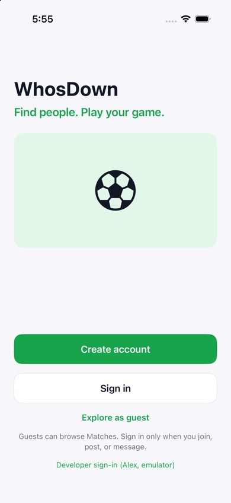
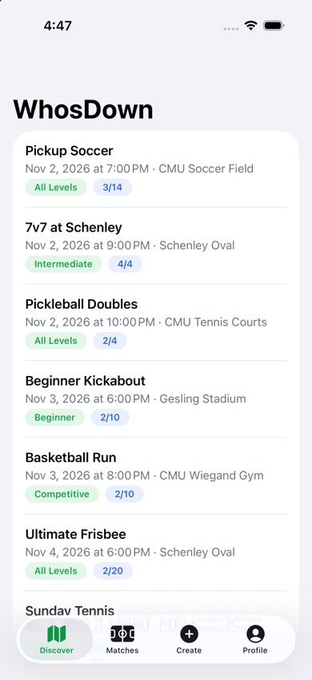
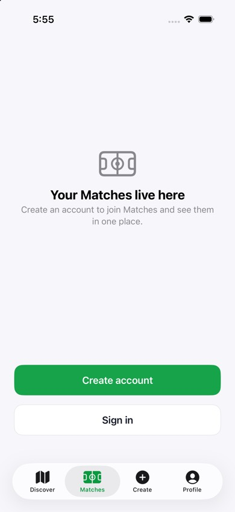
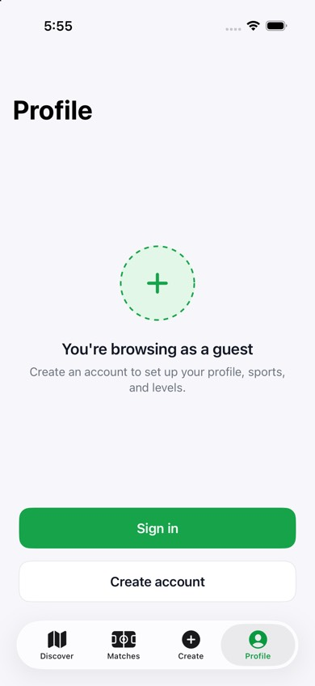
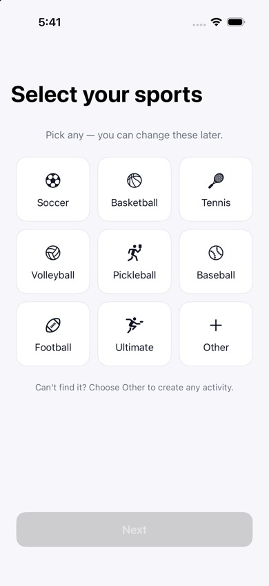
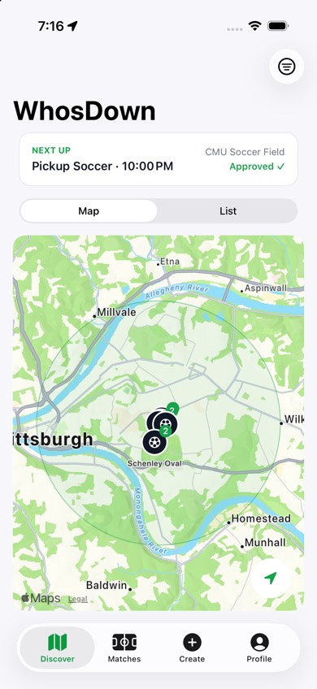
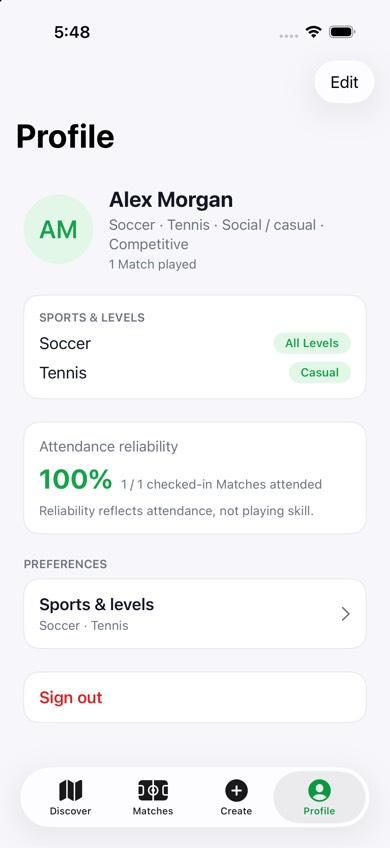
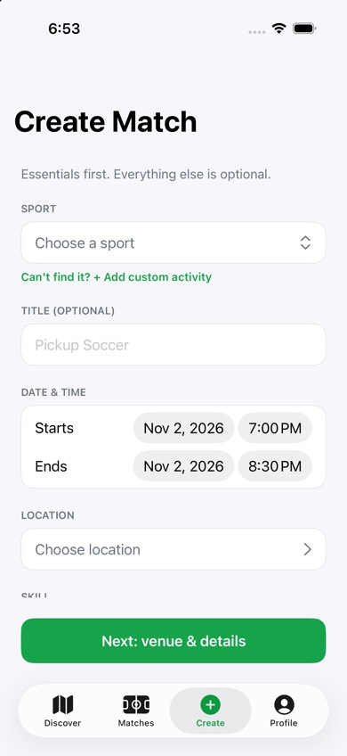

# WhosDown V1 Progress

**Version:** 1.0 · **Last updated:** 2026-11-09 · **Status:** Phase 7/8 implementation and automated acceptance complete; Firebase Storage production setup remains an owner action

Where the V1 build stands, what you can see in the app today, and how to try it yourself. Update this page at the end of every phase. The [build plan](v1-build-plan.md) has the phases; each [feature brief](features/) has the details.

## 1. At a glance

| | |
|---|---|
| Features done | **28 of 28 implemented**; exhaustive release sign-off and production deployment remain separate |
| Phases done | **0–8 implementation complete**; Phases 7/8 automated acceptance passed. See [acceptance and hand-off](phase-8-audit.md). |
| Swift tests | **122 Swift tests pass; all 9 Phase 7 feature UI tests pass**. Delivered-notification cold launch passes in isolation; its banner check is intermittent in the combined UI suite. |
| Screen audit | **45 screens passed** at default and Accessibility XXXL text sizes, with screenshots captured |
| Security-rule tests | **82 passing** across 13 files, including Firestore and Storage, reports, and lifecycle integrity regressions. |
| Pull requests merged | #29–#39 |
| Core loop ("V1 is done when", plan §1) | Two-simulator publish/discover/request/approve/My Matches/chat acceptance passed |

## 2. Phases

| Phase | Features | Status |
|---|---|---|
| 0 Foundation | 1.1 | ✅ Done (PRs #29, #30) |
| 1 Identity | 1.2, 1.3, 1.4, 1.22 | ✅ Done (PRs #31–#35) |
| 2 Hosting | 1.12, 1.11 | ✅ Done (PRs #37, #38) |
| 3 Discover | 1.5–1.10 | ✅ Done (PR #39), approved by Chris in the simulator |
| 4 Joining | 1.13–1.16 | ✅ Done (2026-11-06) |
| 5 Follow-through | 1.19, 1.20 | ✅ Done (2026-11-06) |
| 6 Lifecycle | 1.17, 1.18, 1.21, 1.27, 1.28 | ✅ Done (2026-11-06) |
| 7 Device + safety | 1.23, 1.24, 1.25 | ✅ Implementation and automated acceptance pass |
| 8 Finish | 1.26, final rules | Implementation complete; 45-screen text-size audit and two-simulator core loop pass. The combined simulator UI suite has one intermittent notification-banner failure. Firestore rules/indexes deployed; Storage production setup is an owner action. |

## 3. What works now

**Foundation (1.1)**

- Xcode project in strict MVVM folders: `Models/`, `Views/`, `ViewModels/` (ADR-0009). Firebase 13.1.1, iOS 26, Xcode 27's default Swift settings.
- Debug builds run against the local Firebase emulator as `demo-whosdown`; Release builds use the real `whosdown-57e99`.
- Seed data: 6 test Players, 5 Pittsburgh Venues, 11 Matches covering every case ([firebase/seed/README.md](../firebase/seed/README.md)).
- GitHub: issues #1–#28, [project board](https://github.com/users/cylee33/projects/2), PR template.

**Account and sign-in (1.2):** create account, sign in, password reset, sign out. Errors are plain sentences, and the app stays signed in between launches.

**Guest browsing (1.3):** "Explore as guest" lets someone browse without an account. Anything that needs an account opens the sign-in sheet (H34). Creating an account from there keeps the same user, and the Guest stays on their screen. Matches, Create, and Profile show Guest versions.

**Onboarding (1.4):** H03 sports (plus a custom "Other") → H42 levels → H04 photo, play style, bio, home area → H05 location and notifications → H44. Each step saves as you go, and closing the app resumes where you stopped. Photos are cropped to 512 × 512 and stored in Firebase Storage.

**Profile (1.22):** your own profile (H36) with sports and levels, Reliability, and Sign out; editing (H49); other Players' profiles (H10). Reliability is counted from check-ins (R20) and is ready for 1.10 to reuse.

**Choose location (1.12):** H40 shows saved Venues within 5 miles, nearest first, and Apple Maps search. A new place is saved as a Venue after three quick questions (indoor/outdoor, surface, lights), and the same field is never saved twice. A Swift port of Firebase's geohash library powers the radius search (D50).

**Create Match (1.11):** H17 essentials → H18 Venue & details → H19 review → publish → H45. The Host counts as the first Player, the title defaults to "Pickup {Sport}", and the Match, the Host's RSVP, and the Match chat are written together, so new Matches show up in Discover right away.

**Discover (1.5–1.10):** a map of nearby Matches (sport pins per Venue, radius circle, "Next up"), a list sorted soonest first, filters (sport, time incl. custom days and hours, distance, skill, join type), live Match details with weather, Venue facts, players and the Host, and the roster with Reliability.

**Joining (1.13–1.16):** an Open Match joins in one tap and shows H14. An Approval-required Match opens the H12 sheet, writes a pending RSVP, and turns green or red when the Host approves or declines from H20/H21. Leave and cancel-request confirm with a bottom sheet. Guests still hit H34. The Host has Manage Match and no Leave button. Chat on H14 is live. The calendar button opens the system event editor before the Match starts.

**My Matches (1.19):** Upcoming, Hosting, and Past. Hosting opens the dashboard. A Match moves to Past on the device once it ends. Past hosted rows show Check in while the window is open.

**Match chat (1.20):** approved Players and the Host post in H16. The Host's messages are labeled. Entry points are H14 and H20.

**Waitlist (1.17):** a full Match with the waitlist on shows H15. Joining appends the Player to `waitlistIds`. On an Open Match, the first person in line is approved in the same write as a leave. On an Approval-required Match, the Host gets `spotOpened` and approves from the Waitlist section on H21.

**Edit and cancel (1.18):** H46 saves time, place, limit, join type, and description. Approved Players are notified unless the only change is the description or the Host turns notify off. Cancel asks for a reason and notifies approved, pending, and waitlisted Players. Raising the limit on an Open Match lets the line in as follow-up writes, after the edit saves.

**Notifications (1.21):** the bell on Discover and My Matches shows the unread count. The list marks one or all as read and deletes on swipe. The detail shows changed fields, the Host note, and a link to the Match.

**Check-in (1.27):** from the start until 48 hours after the end, H20 and past hosted rows open check-in. The Host is always attended. Submit writes `checkedIn` and `attended`.

**Transfer host (1.28):** H20 lists approved Players. The chosen Player becomes `hostId` immediately and gets `hostTransferred`.

**Calendar (1.23):** H14 and the H09 menu open the system event editor with title, start/end, Venue name/address and Host notes. Only the Host and approved Players can add upcoming Matches. Saved events are not tracked or updated.

**Reminders (1.24):** one-hour local reminders reconcile on launch/foreground and live RSVP/Match changes, across all tabs. Leaving, cancellation and time changes update the plan. Tapping a reminder opens Match details. Permission is asked only during H05; denied permission has a once-per-account H14 explanation. Sign-out/account changes clear old reminders.

**Safety reports (1.25):** Match actions and another Player's profile open H33. Reasons and optional details create private, create-only reports; Guests get the account gate. Real emulator writes and authorization rules are tested.

**Finish pass (1.26):** shared scrollable sheets, progress and duplicate-action guards, in-sheet errors, inbox/chat empty states, wrapping text, adaptive sports columns, spacing/color tokens and cross-tab roster/profile navigation. Final rules restrict lifecycle writes and prevent repeated joins inflating counts. All 45 screens passed default and Accessibility XXXL simulator audits; manual VoiceOver and physical-device checks remain optional release QA. See [the audit](phase-8-audit.md) for evidence and the Storage setup hand-off.

## 4. Screens in the simulator

Taken on 2026-11-02 from the Debug build against the seeded emulator.

| Welcome (H01) | Guest: Discover | Guest: Matches tab | Guest: Profile tab |
|---|---|---|---|
|  |  |  |  |

| Onboarding: sports (H03) | Discover map (H06) | Profile (H36) | Create Match (H17) |
|---|---|---|---|
|  |  |  |  |

**Not yet checked by hand:** H02, H41, H34, H42, H04, H05, H44, H49, H10, H40, H18, H19, H45. Automated coverage and the 45-screen audit passed; manually compare these flows against Figma as optional release QA.

## 5. Try it yourself

1. Follow [CONTRIBUTING §2](../CONTRIBUTING.md) once: clone outside iCloud, `npm install` in `firebase/`, Java 21.
2. Terminal 1: `cd firebase && npm run emulators`. Terminal 2: `cd firebase && npm run seed`.
3. Open `app/WhosDown.xcodeproj`, choose an iOS 26 simulator, and press Run.
4. To skip typing, set these in the scheme (Product → Scheme → Edit Scheme → Run → Arguments → Environment Variables):

| Variable | Opens as |
|---|---|
| `WHOSDOWN_DEV_SIGNIN=1` | Alex, a seeded Player |
| `WHOSDOWN_DEV_SIGNIN=guest` | A Guest |
| `WHOSDOWN_DEV_SIGNIN=newbie@whosdown.test` | A Player who hasn't finished onboarding |
| `WHOSDOWN_DEV_TAB=profile` (or `matches`, `create`) | That tab |

All test passwords are `whosdown123`.

## 6. Changed or decided while building

| What | Why | Record |
|---|---|---|
| Strict MVVM folders replace feature folders + core package | Owner asked for Models / Views / ViewModels | ADR-0009, D49 |
| Waitlist without 10-minute spot offers | Owner's call: Open Matches move the line up automatically; the Host approves on Approval-required Matches | ADR-0008, D47 |
| Own geohash helper instead of GeoFireUtils | GeoFireUtils doesn't work with Firebase 13 | D50 |
| Data models without `@DocumentID` | Its wrapper conflicts with Xcode 27's concurrency defaults | lessons-learned |
| Repo moved to `~/Developer/WhosDown` | iCloud Desktop sync made " 2" copies that broke the build | D52 |
| First launch after install signs out | Firebase's sign-in survives uninstall (Keychain) | PR #35 |
| Reliability (R20) built in 1.22 | The profile shows it; 1.10 reuses it | 1.22 brief |

## 7. Next

- **Release QA:** Calendar save/cancel, notification cold launch to Match, 45-screen default/XXXL audit, and two-simulator core loop passed. Optional checks: physical locked-phone delivery and a manual VoiceOver walk-through. See [Phase 8 acceptance](phase-8-audit.md).
- **Still to tap through:** the Phase 6 screens (waitlist, edit, inbox, check-in, transfer). Rules tests cover the writes.
- **Chris, around 2026-11-04:** once the Student Developer Pack is active, turn on branch protection for `main`, then add Jaimin and Kurt (D14).
- **Owner action:** Storage deployment is blocked by disabled billing and uninitialized Storage. After enabling the required billing plan and initializing Storage, verify the bucket and deploy Storage rules as described in the [hand-off](phase-8-audit.md). Firestore rules/indexes are already deployed.

## Changelog

| Version | Date | Author | Change |
|---|---|---|---|
| 0.1 | 2026-11-02 | Chris Lee (with Claude) | First progress report: Phases 0 and 1, screenshots, how to run, decisions made while building |
| 0.2 | 2026-11-02 | Chris Lee (with Claude) | Phase 2 done: 1.12 and 1.11 |
| 0.3 | 2026-11-02 | Chris Lee (with Claude) | Phase 3 done |
| 0.4 | 2026-11-06 | Kurt Schimmel | Phase 4 done: join, request, approve/decline, leave |
| 0.5 | 2026-11-06 | Kurt Schimmel | Phase 5 done: My Matches and Match chat |
| 0.6 | 2026-11-06 | Kurt Schimmel | Phase 6 done: waitlist, edit and cancel, inbox, check-in, transfer host |

| 0.7 | 2026-11-08 | Codex | Implemented Phases 7/8, 117 Swift and 81 rules tests pass; documented device acceptance and production deployment still pending |

| 0.8 | 2026-11-08 | Codex | Completed remaining Phase 8 gaps; 122 Swift, nine simulator UI, and 82 rules tests pass. Feature implementation is complete; release sign-off and deployment tracked separately |

| 0.9 | 2026-11-08 | Codex | Two-simulator core loop passed and Firestore rules/indexes deployed; exhaustive UI audit underway; Storage requires owner initialization. |
| 1.0 | 2026-11-09 | Codex | Passed 45-screen default/XXXL audits and delivered-notification cold launch; fixed notification delegate crash; Phase 7/8 automated acceptance complete. |
