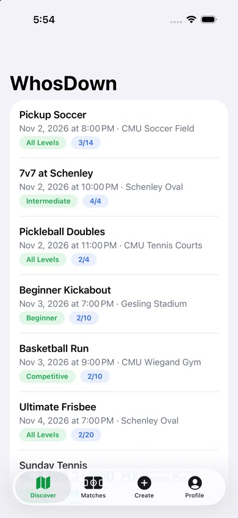

# WhosDown V1 Progress

**Version:** 0.2 · **Last updated:** 2026-11-02 · **Status:** Phases 0–2 done; Phase 3 next

Where the V1 build stands, what you can see in the app today, and how to try it yourself. Update this page at the end of every phase. The [build plan](v1-build-plan.md) has the phases; each [feature brief](features/) has the details.

## 1. At a glance

| | |
|---|---|
| Features done | **7 of 28** (1.1, 1.2, 1.3, 1.4, 1.11, 1.12, 1.22) |
| Phases done | **0 Foundation, 1 Identity, 2 Hosting** (of 0–8) |
| Swift tests | **72 passing** (9 of them run the real Firebase code against the local emulator) |
| Security-rule tests | **40 passing** (Firestore and Storage) |
| Pull requests merged | #29–#38 |
| Core loop ("V1 is done when", plan §1) | Not yet; needs Phases 2–5 |

## 2. Phases

| Phase | Features | Status |
|---|---|---|
| 0 Foundation | 1.1 | ✅ Done (PRs #29, #30) |
| 1 Identity | 1.2, 1.3, 1.4, 1.22 | ✅ Done (PRs #31–#35) |
| 2 Hosting | 1.12, 1.11 | ✅ Done (PRs #37, #38) |
| 3 Discover | 1.5–1.10 | Next |
| 4 Joining | 1.13–1.16 | Not started |
| 5 Follow-through | 1.19, 1.20 | Not started (core loop done here) |
| 6 Lifecycle | 1.17, 1.18, 1.21, 1.27, 1.28 | Not started |
| 7 Device + safety | 1.23, 1.24, 1.25 | Not started |
| 8 Finish | 1.26, final rules | Not started |

## 3. What works now

**Foundation (1.1)**

- Xcode project in strict MVVM folders: `Models/`, `Views/`, `ViewModels/` (ADR-0009). Firebase 13.1.1, iOS 26, Xcode 27's default Swift settings.
- Debug builds run against the local Firebase emulator as `demo-whosdown`; Release builds use the real `whosdown-57e99`.
- Seed data: 6 test Players, 5 Pittsburgh Venues, 10 Matches covering every case ([firebase/seed/README.md](../firebase/seed/README.md)).
- GitHub: issues #1–#28, [project board](https://github.com/users/cylee33/projects/2), PR template.

**Account and sign-in (1.2):** create account, sign in, password reset, sign out. Errors are plain sentences, and the app stays signed in between launches.

**Guest browsing (1.3):** "Explore as guest" lets someone browse without an account. Anything that needs an account opens the sign-in sheet (H34). Creating an account from there keeps the same user, and the Guest stays on their screen. Matches, Create, and Profile show Guest versions.

**Onboarding (1.4):** H03 sports (plus a custom "Other") → H42 levels → H04 photo, play style, bio, home area → H05 location and notifications → H44. Each step saves as you go, and closing the app resumes where you stopped. Photos are cropped to 512 × 512 and stored in Firebase Storage.

**Profile (1.22):** your own profile (H36) with sports and levels, Reliability, and Sign out; editing (H49); other Players' profiles (H10). Reliability is counted from check-ins (R20) and is ready for 1.10 to reuse.

**Choose location (1.12):** H40 shows saved Venues within 5 miles, nearest first, and Apple Maps search. A new place is saved as a Venue after three quick questions (indoor/outdoor, surface, lights), and the same field is never saved twice. A Swift port of Firebase's geohash library powers the radius search (D50).

**Create Match (1.11):** H17 essentials → H18 Venue & details → H19 review → publish → H45. The Host counts as the first Player, the title defaults to "Pickup {Sport}", and the Match, the Host's RSVP, and the Match chat are written together, so new Matches show up in Discover right away.

**Placeholders until their feature is built:** Discover is a plain list of upcoming Matches (1.5/1.6 replace it), and the Matches tab says "Coming in 1.19".

## 4. Screens in the simulator

Taken on 2026-11-02 from the Debug build against the seeded emulator.

| Welcome (H01) | Guest: Discover | Guest: Matches tab | Guest: Profile tab |
|---|---|---|---|
|  |  |  |  |

| Onboarding: sports (H03) | Discover (placeholder list) | Profile (H36) | Create Match (H17) |
|---|---|---|---|
|  |  |  |  |

**Not yet checked by hand:** H02, H41, H34, H42, H04, H05, H44, H49, H10, H40, H18, H19, H45. Scripts can't tap the simulator, so these are covered by tests and SwiftUI previews only. Check them against Figma in the 1.26 audit, or tap through them in Xcode.

## 5. Try it yourself

1. Follow [CONTRIBUTING §2](../CONTRIBUTING.md) once: clone outside iCloud, `npm install` in `firebase/`, Java 21.
2. Terminal 1: `cd firebase && npm run emulators`. Terminal 2: `cd firebase && npm run seed`.
3. Open `app/WhosDown.xcodeproj`, choose an iOS 26 simulator, and press Run.
4. To skip typing, set these in the scheme (Product → Scheme → Edit Scheme → Run → Arguments → Environment Variables):

| Variable | Opens as |
|---|---|
| `WHOSDOWN_DEV_SIGNIN=1` | Alex, a seeded Player |
| `WHOSDOWN_DEV_SIGNIN=guest` | A Guest |
| `WHOSDOWN_DEV_SIGNIN=newbie@whosdown.test` | A Player who hasn't finished onboarding |
| `WHOSDOWN_DEV_TAB=profile` (or `matches`, `create`) | That tab |

All test passwords are `whosdown123`.

## 6. Changed or decided while building

| What | Why | Record |
|---|---|---|
| Strict MVVM folders replace feature folders + core package | Owner asked for Models / Views / ViewModels | ADR-0009, D49 |
| Waitlist without 10-minute spot offers | Owner's call: Open Matches move the line up automatically; the Host approves on Approval-required Matches | ADR-0008, D47 |
| Own geohash helper instead of GeoFireUtils | GeoFireUtils doesn't work with Firebase 13 | D50 |
| Data models without `@DocumentID` | Its wrapper conflicts with Xcode 27's concurrency defaults | lessons-learned |
| Repo moved to `~/Developer/WhosDown` | iCloud Desktop sync made " 2" copies that broke the build | D52 |
| First launch after install signs out | Firebase's sign-in survives uninstall (Keychain) | PR #35 |
| Reliability (R20) built in 1.22 | The profile shows it; 1.10 reuses it | 1.22 brief |

## 7. Next

- **Phase 3 Discover:** 1.5 map, 1.6 list, 1.7 filters, 1.8 Match details, 1.9 weather, 1.10 roster. Done when a Player finds a published Match on the map and list and opens its details.
- **Chris, around 2026-11-04:** once the Student Developer Pack is active, turn on branch protection for `main`, then add Jaimin and Kurt (D14).
- **Before 2026-11-24:** deploy real security rules to `whosdown-57e99` (test mode expires; 1.26).

## Changelog

| Version | Date | Author | Change |
|---|---|---|---|
| 0.1 | 2026-11-02 | Chris Lee (with Claude) | First progress report: Phases 0 and 1, screenshots, how to run, decisions made while building |
| 0.2 | 2026-11-02 | Chris Lee (with Claude) | Phase 2 done: 1.12 and 1.11 |
